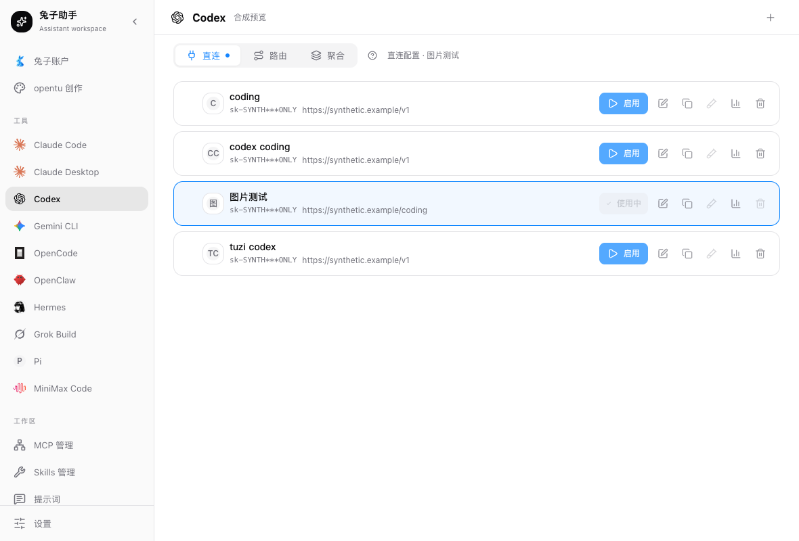
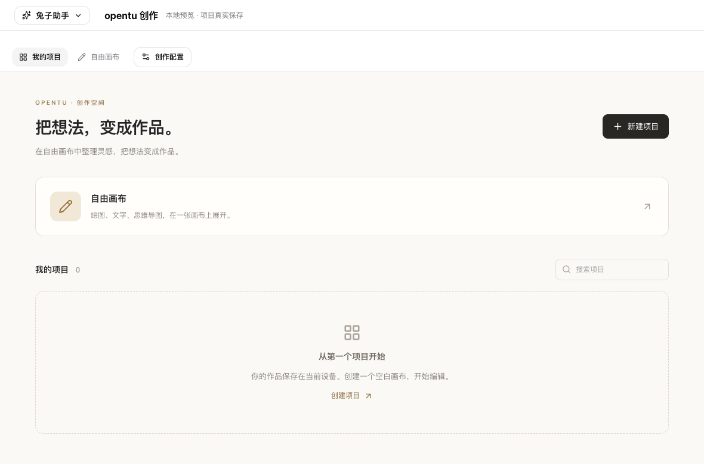

<div align="center">


# 兔子助手 · tuzi-switch

**把 AI 工具配置、兔子账户和 opentu 创作，放进同一个桌面。**

[](https://github.com/tuziapi/tuzi-switch/releases)
[](https://github.com/tuziapi/tuzi-switch/releases)
[](https://github.com/tuziapi/tuzi-switch/releases)
[](src-tauri/tauri.conf.json)

[**下载安装**](https://tuziapi.github.io/tuzi-switch/) · [**版本发布**](https://github.com/tuziapi/tuzi-switch/releases) · [**问题反馈**](https://github.com/tuziapi/tuzi-switch/issues)

</div>

兔子助手是一款基于 Tauri 2 的桌面应用。你可以在一个客户端里管理不同 AI 工具的供应商与模型配置，查看兔子账户的 API 密钥、调用明细和模型信息，再进入 opentu 自由画布进行文字、图片、视频和音乐创作。

它适合同时使用多个 AI 工具、需要切换模型服务的开发者，也适合希望把生成素材与创作项目集中整理的用户。已有第三方模型服务时，可以保留手动配置；使用兔子账户时，可以从账户中选择模型 Key 配置到工具或创作工作区。

> 当前正式版本：**v1.5.5**。正式仓库为 **tuziapi/tuzi-switch**，**AiW520/tuzi-switch** 为测试仓库。当前提供完整安装包；本次重建支持正式新版提醒和手动下载，应用内自动安装暂不可用。Mac 版尚未进行 Apple 开发者签名或公证。

## 阅读导航

[产品能力](#产品能力) · [下载安装](#下载安装) · [首次使用](#首次使用) · [数据与凭证](#数据与凭证) · [版本更新](#版本更新) · [常见问题](#常见问题) · [开发与构建](#开发与构建)

## 产品能力

### 三个工作区，各自负责什么

| 工作区 | 可以做什么 | 典型用法 |
| --- | --- | --- |
| 工具管理 | 管理供应商、模型和工具配置，使用适用工具的 MCP、提示词、Skills 与会话入口 | 为 Codex 配置一个模型服务，再为 Claude Code 配置另一条线路 |
| 兔子账户 | 管理 API 密钥，查看调用记录、消费统计、模型价格和服务状态 | 找到可用模型与 Key，检查一次请求的用量、耗时或错误 |
| opentu 创作 | 管理项目，在自由画布中组织文字、绘图和生成素材 | 将参考图、提示词、生成图片及视频放在同一张画布里整理 |

工具管理和账户页使用侧栏导航。进入创作后，导航收起为顶部“兔子助手”菜单，为画布留出空间；可以随时返回其他工作区。

### 工具管理：按工具配置，按需切换

目前提供以下工具入口：

| 类型 | 工具 | 管理方式 |
| --- | --- | --- |
| 编程与模型工具 | Claude Code、Claude Desktop、Codex、Gemini CLI、OpenCode | 各自独立的供应商与配置页面 |
| Agent 工具 | OpenClaw、Hermes | 供应商配置及对应工具的专用设置 |
| 原生配置入口 | Grok Build、Pi、MiniMax Code | 读取和编辑工具配置，选择供应商，并提供配置恢复入口 |

主要操作包括：

- **管理供应商**：新增、编辑和切换模型服务；按工具填写接口地址、API Key、模型及协议。
- **从账户配置到工具**：从兔子账户选择 Key 和模型，检查可用分组、模型限制与协议兼容性，再确认写入对应工具。
- **MCP、提示词与 Skills**：集中管理适用工具的扩展服务和提示内容，减少来回编辑配置文件。
- **本地工作区**：提供 Agent 文件、统一供应商和本地调用统计入口；本地统计与兔子账户的服务端消费记录分别展示。
- **会话与工具授权**：通过独立入口管理支持的会话记录、ChatGPT / GitHub Copilot 工具授权；它们与兔子账户连接分开。
- **工具专用设置**：保留 Codex、OpenClaw 等工具各自的配置行为，不把一套配置强行写入所有工具。

工具入口不等于内置了对应 CLI。使用前仍需安装该工具及其运行环境；工具间的协议、MCP、Skills、授权和同步能力并不完全相同，以对应页面为准。Claude Desktop 不支持 Linux。

### 兔子账户：从密钥到调用记录

账户页面开放四个横向 Tab：

| 页面 | 具体内容 |
| --- | --- |
| API 密钥 | 查看和管理模型 Key，检查状态、额度与限制，并进入“配置到工具”流程 |
| 调用明细 | 按条件查询请求，查看消费、Token、耗时及公开错误信息；列表下方展示消费统计和模型排行 |
| 模型广场 | 搜索模型，按供应商、协议、计费方式和分组筛选，查看模型详情与价格信息 |
| 模型服务状态 | 查看模型近期成功率与服务状态，辅助判断请求异常是否与服务有关 |

充值、兑换等操作从账户入口前往网站完成。账户设置按钮目前暂时隐藏，账户四个 Tab 仍可使用。

### opentu 创作：项目与自由画布

- **我的项目**：新建、搜索和打开画布项目，继续编辑本机保存的作品。
- **自由画布**：把文字、绘图、思维导图和参考素材放在同一工作区，围绕素材继续创作。
- **AI 生成**：按所选模型能力使用文字、图片、视频和音乐生成；图片支持批量生成及适用的编辑、蒙版操作。
- **素材操作**：查看生成结果和任务队列，对图片进行复制、保存、定位文件等操作，并导出项目文件。
- **创作配置**：从兔子账户关联模型 Key，或手动配置已有服务；沿用工作区内的供应商与模型设置。

实际可用的生成动作取决于模型、接口协议、Key 权限和供应商支持。并非所有模型都支持全部媒体功能，模型调用费用按所用服务计费。

当前创作入口为“我的项目”和“自由画布”，不提供独立工作流编辑页面。部分视频、音乐结果保留远程资源引用，不能将项目保存理解为所有媒体都已完整离线归档。

<details>
<summary><strong>查看界面示例</strong></summary>

以下为仓库内已有的界面示例，包含预览环境与示例数据；具体内容以当前安装版本为准。

**工具管理**



**opentu 项目空间**



</details>

## 下载安装

**推荐使用 [正式下载页](https://tuziapi.github.io/tuzi-switch/)**，也可直接查看 [v1.5.5 发布说明与安装附件](https://github.com/tuziapi/tuzi-switch/releases/tag/v1.5.5)。

| 平台 | 安装文件 | 如何选择 |
| --- | --- | --- |
| macOS Apple 芯片 | `tuzi-assistant-macos-arm64.dmg` | M 系列芯片 |
| macOS Intel | `tuzi-assistant-macos-x64.dmg` | Intel 处理器 |
| Windows x64 | `tuzi-assistant-windows-x64.exe` / `.msi` | Intel / AMD 64 位电脑 |
| Linux x64 | `tuzi-assistant-linux-x64.AppImage` / `.deb` / `.rpm` | 按发行版选择安装格式 |

Mac 最低系统版本在打包配置中设为 macOS 12.0。当前没有 Windows ARM64 或 Linux ARM64 专用安装包。Release 同时提供 `SHA256SUMS`、构建信息和源码归档，供核对文件来源与完整性。

### macOS：终端安装

先完全退出兔子助手，将下面整行命令粘贴到“终端”，按提示确认。

**安装当前支持版本：**

```bash
(s=$(curl -fsSL https://tuziapi.github.io/tuzi-switch/install.sh) && bash -c "$s")
```

**明确指定 v1.5.5：**

```bash
(s=$(curl -fsSL https://tuziapi.github.io/tuzi-switch/install.sh) && bash -c "$s" -- --version v1.5.5)
```

目前两条命令都安装 **v1.5.5**。本次为同版本重建，已安装旧 v1.5.5 的用户需重新下载安装才能获得新增修复。指定版本仅支持该版本，不能任意替换为旧版本；也兼容 `TUZI_SWITCH_TAG=v1.5.5`，显式 `--version` 优先。

脚本会自动识别 Apple 芯片 / Intel，校验安装器及 DMG 的 SHA-256、应用身份和包内签名完整性，替换前备份旧应用。安装与放行分别需要用户确认，不需要 `sudo`，不修改账户和作品配置。实际安装目录以终端提示为准，应用名为 **兔子助手.app**。

此脚本仅适用于 macOS。[查看安装器源码](scripts/install-macos.sh)。兼容入口 `scripts/install_tuzi_switch.sh` 已接入正式下载：Mac 转入同一校验安装器，Linux x86_64 下载 AppImage 并核对 SHA256SUMS；可加 `--verify-only` 仅验证。

### 手动安装

- **macOS**：选择对应芯片的 DMG，退出旧版后，将“兔子助手”拖入“应用程序”并替换。
- **Windows**：下载 EXE 或 MSI，双击并按安装向导操作。
- **Linux**：DEB / RPM 使用对应发行版的软件包安装工具安装；AppImage 授予可执行权限后运行。

当前 Mac 版未经 Apple 开发者签名或公证，Windows 安装包也尚未进行开发者签名，系统可能提示未知发布者。Mac 如被拦截，可使用上述终端安装流程：核对来源并确认信任后，仅移除兔子助手副本的下载隔离标记，不关闭系统全局安全检查。此流程不等于 Apple 签名或公证。

## 首次使用

### 1. 连接兔子账户，或使用已有模型服务

如果使用兔子账户：

1. 打开“兔子账户”，点击“前往获取系统令牌”。
2. 在网站登录并复制**账户系统令牌**。
3. 返回客户端，将令牌填入账户连接框，确认连接。
4. 连接后进入“API 密钥”，选择用于模型调用的 Key。

如果已有其他供应商的模型服务，可以直接进入工具页面或“创作配置”，手动填写服务地址、API Key 和模型。手动配置无需先连接兔子账户。

**账户系统令牌、模型 Key 和工具登录不是一回事：**

| 凭证 | 用途 | 应填在哪里 |
| --- | --- | --- |
| 账户系统令牌 | 连接兔子账户，查询和管理账户业务 | “兔子账户”的连接框 |
| 模型 API Key | 调用模型，受额度、分组及模型权限约束 | 工具供应商配置或创作配置 |
| 工具自身的 OAuth / 登录凭证 | 使用 ChatGPT、GitHub Copilot 等工具授权 | 对应工具的授权流程 |

不要把账户系统令牌作为模型 API Key 填入工具。账户连接成功，也不代表每个模型和协议都对当前 Key 开放。

### 2. 配置一个 AI 工具

1. 先安装要使用的工具及其依赖。
2. 在兔子助手中选择对应工具，添加供应商；或从账户 Key 的“配置到工具”入口开始。
3. 选择兼容的接口协议、模型与 Key，检查将要写入的配置后确认。
4. 回到对应工具使用；如工具仍在运行，按其要求重新加载配置或重启。

例如，配置 Codex 时使用兼容的 Responses 服务；配置 Claude Code 时使用兼容的 Anthropic 服务。同一把 Key 能否用于两者，仍取决于它的权限及服务提供的协议。

### 3. 开始一个创作项目

1. 打开“opentu 创作” → “我的项目”，新建或打开项目。
2. 进入“创作配置”，关联兔子账户中的模型 Key，或手动配置模型服务。
3. 在自由画布添加文字、参考图等素材，选择支持相应动作的模型后提交。
4. 在任务队列查看进度，结果返回后继续编辑、保存素材或导出项目。

切换到工具或账户页面后，可再次返回创作查看项目和任务结果。退出应用前请确认项目已保存，并检查仍在运行的生成任务。

## 数据与凭证

| 数据 | 保存与使用方式 |
| --- | --- |
| 助手配置 | 默认使用 `~/.tuzi-switch/` 下的数据库、设置和备份；自定义目录以应用设置为准 |
| 工具配置 | 写入各工具自己的配置位置，例如 Codex 的 `~/.codex/config.toml`；不同工具的凭证保存方式不同 |
| 兔子账户系统令牌 | 由原生层保存在独立本地 JSON 文件，位于系统本地应用数据目录；Unix 目录权限为 0700、文件为 0600 |
| 创作项目与素材 | 通过创作模块的本地存储保存；项目导出与备份用于另外保存或迁移作品，远程媒体引用仍可能依赖网络 |

账户系统令牌采用本地文件保存，**不是钥匙串存储，也不是加密保险库**；不进入工具配置、普通数据库导出或 WebDAV 同步。不要将该文件、模型 Key 或包含凭证的配置提交到仓库、公开问题或截图中。

本地保存项目不意味着模型在本机运行。发起模型请求时，提示词及所选参考素材会按对应服务接口发送给所配置的模型服务。

断开兔子账户只清除此设备的账户连接，不会撤销网站上的系统令牌。若需使令牌失效，应在网站处理；重新连接时使用当前令牌。

## 版本更新

v1.5.5 使用**完整安装包更新**。本次未发布更新签名及自动更新清单，应用内自动更新暂不可用；请使用正式下载页或 Mac 终端安装命令。

正式版保留原有应用身份与数据路径。更新前退出旧版，并使用对应平台的正式安装包；重要作品建议另行导出备份。

测试仓库与正式仓库的更新渠道不同。已安装测试渠道版本的用户，需要手动安装正式版才能转入正式渠道；不会自动搬迁测试数据或轮换凭证。旧版独立 opentu 的作品也不保证自动出现在统一客户端中，迁移前请先导出并保留原文件。

本版发布来源、构建和校验记录见 [v1.5.5 交付记录](docs/development/2026-11-05-v1.5.5-manual-delivery.md)。安装包构建和摘要检查通过，不代表 Windows、Linux、Intel Mac 的全部实机安装与业务流程都已验收。

## 常见问题

### 为什么脚本下载成功，安装包却下载失败？

脚本由 GitHub Pages 提供，安装包来自 GitHub Releases，属于不同的下载链路。脚本返回 `OK` 只表示安装器摘要校验通过，并不表示安装包已经下载或应用已经安装。

| 现象 | 原因与处理 |
| --- | --- |
| 下载 `tuzi-switch-macos-aarch64.dmg` 返回 404 | 运行了旧脚本，请改用本页的正式安装命令 |
| `mirror.ghproxy.com` SSL 错误 | 旧脚本的镜像回退失败；新入口不使用该镜像 |
| `curl (28)` / `curl (16)` | 连接超时或 HTTP/2 传输失败；更换能稳定访问 GitHub 的网络后重试，或尝试从下载页手动获取安装包 |
| 下载速度很低 | 当前到 GitHub 的链路较慢；仅更换脚本地址不会加速安装包 |

当前安装器尚未加入 HTTP/1.1 回退和跨次断点续传。若在安装包下载阶段退出，原应用不会被替换，重跑会重新下载。文档中的新命令解决旧入口的使用问题，不代表这些网络容错限制已修复。

### 为什么账户连接成功，却无法调用某个模型？

账户系统令牌只负责账户连接。调用模型还需要有效的模型 Key、可用额度、匹配的分组与模型权限，以及工具支持的协议。先检查 Key 状态与模型限制，再查看调用明细中的公开错误和模型服务状态。

### 不连接兔子账户还能使用吗？

可以。工具供应商与创作设置保留手动配置，已有模型服务可自行填写。账户密钥、消费查询和账户模型目录等功能则需要连接兔子账户。

### 作品能完全离线保存吗？

项目在本机保存，也可以导出项目文件；但部分视频和音乐包含远程资源引用，地址失效或断网后可能无法重新加载。重要素材请另行下载保存，不要仅依赖项目中的链接。

### 如何反馈问题？

到 [Issues](https://github.com/tuziapi/tuzi-switch/issues) 提供系统与芯片、客户端版本、安装来源、复现步骤和报错信息。下载问题请注明运行的命令及 curl 错误码；隐藏系统令牌、API Key、个人路径和敏感提示词。

## 开发与构建

普通用户只需下载安装包。以下内容面向需要修改源码的开发者。

### 环境与启动

- Node.js 20.19+（20 系列）或 22.12+，pnpm 9；发布工作流使用 Node.js 20 与 pnpm 9。
- Rust 版本按 [rust-toolchain.toml](rust-toolchain.toml) 安装，目前固定为 1.95。
- 本机还需具备 Tauri 2 对应平台的原生编译工具及系统依赖；可参考 [发布工作流](.github/workflows/unified-release.yml) 的构建环境。

```bash
git clone https://github.com/tuziapi/tuzi-switch.git
cd tuzi-switch
pnpm install --frozen-lockfile
pnpm dev
```

`pnpm dev` 会构建创作模块并启动 Tauri 开发应用，会使用桌面能力及本地配置。仅查看前端界面时可使用 `pnpm dev:renderer`；浏览器预览不能替代原生功能验证。

### 常用命令

| 命令 | 用途 |
| --- | --- |
| `pnpm build:creative` | 构建内置创作模块 |
| `pnpm build:renderer` | 构建创作模块及宿主前端 |
| `pnpm build` | 构建桌面应用，打包与签名条件需按平台配置 |
| `pnpm typecheck` | TypeScript 类型检查 |
| `pnpm test:unit` | 宿主单元测试，依赖创作产物时先运行 `pnpm build:creative` |
| `pnpm test:creative` | 创作模块测试 |
| `pnpm build:download` | 校验公开 Release 元数据并构建下载页，需要联网 |

`pnpm release` / `npm version` 不是普通本地构建命令：本仓库的 `postversion` 会推送分支和标签。发布前请阅读仓库协作规则和渠道说明。

### 仓库结构

| 路径 | 内容 |
| --- | --- |
| `src/` | 桌面前端、工具管理、账户界面及创作宿主 |
| `src-tauri/` | Rust 原生能力、配置读写与桌面打包 |
| `packages/creative-workspace/` | 内置 opentu 创作模块及来源记录 |
| `packages/download-page/` | 正式下载页源码与 Release 元数据校验 |
| `scripts/` | 构建、校验及安装脚本 |
| `docs/development/` | 当前开发基线、决策、兼容和验证记录 |
| `docs/user-manual/` | 分功能使用手册，部分历史页面需结合当前版本阅读 |

参与开发前请阅读 [AGENTS.md](AGENTS.md) 和 [统一开发入口](docs/development/README.md)。账户与工具接入以当前契约、源码和版本记录为准，不使用旧 README 中的历史发布说明作为实现依据。

## 开源来源与许可

兔子助手基于 CC Switch 的桌面与工具管理能力继续开发，创作模块整合了 opentu / Drawnix 的相关实现。感谢上游项目及贡献者。

- 主项目许可见 [LICENSE](LICENSE)。
- 创作模块许可及来源见 [upstream/LICENSE](packages/creative-workspace/upstream/LICENSE) 和 [UPSTREAM.json](packages/creative-workspace/UPSTREAM.json)。
- 下载页包含独立许可，见 [packages/download-page/LICENSE](packages/download-page/LICENSE) 及 [SOURCE.json](packages/download-page/SOURCE.json)。

各模块保留自身的许可与来源记录。
