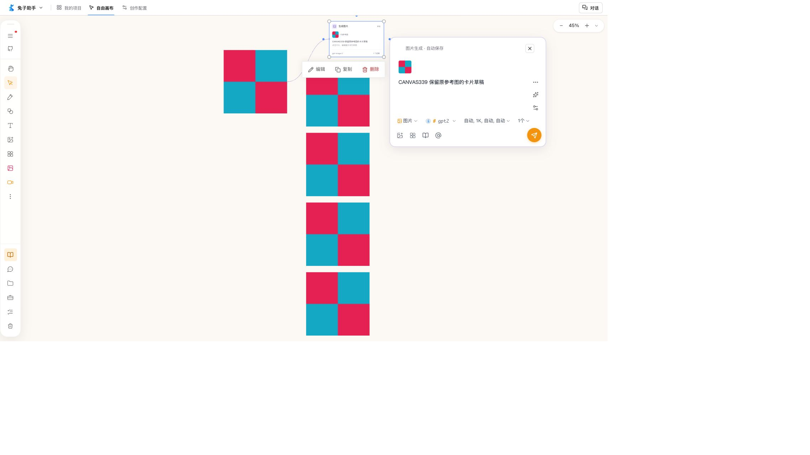

# UC-CANVAS-339：桌面 opentu 生成卡片集成

2026-11-16，用户要求将会话“拉取 develop 分支最新代码”的实现集成到兔子助手桌面 opentu 并测试。本轮为本地集成与验证，不改变已发布 v1.6.2，也未安装覆盖本机正式应用。

## 来源与范围

- 桌面基线：`c299b8df5d03a69afa96b637a1370ebdf3e00f29`。
- 本地分支：`codex/integrate-canvas-generation-339`。
- 来源会话：`01a1c98c-5c80-7f11-ab13-8c7344e32bb0`。
- 来源工作区：`canvas-interaction-polish/opentu1`，分支 `codex/generation-card-actions`。
- 来源 HEAD：`debc11bc56b59c0e06dc8185ae529668a8245cfb`；特性提交 `5ea9eec5d7c9b230a41c56cf54d5e554d8f80be9`，三方合并基线 `73f6e925df2edd3723bef358a21fd51b48492f12`。
- PR #338 已合入 develop；检查时 PR #339 的编辑/复制/删除操作仍为开放状态。本次按指定会话实现一并本地集成，不声称 #339 已合并。
- #339 云端 CI 因 Vite 的 JavaScript heap out of memory 失败，不算通过；本地桌面前端构建通过。上游此前真实生图/视频服务结果不作为本轮桌面验收证明。

采用限定特性文件的三方集成：60 个来源路径中 43 个直接合入、7 个自动合并、10 个手动解决冲突。逐文件记录见 [来源清单](opentu-canvas-339-source.json)。没有整仓覆盖桌面分叉，也没有修改来源工作区。

集成内容：图片连接点拖线创建图片/视频生成卡片，参考连接及去重、顺序/角色管理，持久化提示词与参数，生成结果携带原始输入记录，以及“再次生成 / 调整后生成 / 以此图修改”和卡片“编辑 / 复制 / 删除”。不引入自动执行整张图的 DAG。

## 桌面兼容与发现的问题

| 问题 | 修复与验证 |
| --- | --- |
| 卡片编辑与桌面附加讨论共用输入框 | 编辑卡片时保存讨论状态与原草稿；关闭后恢复；切换画板不带入旧草稿。实际 UI 和回调回归通过。 |
| “调整后生成”在讨论启用时误走规划 | 恢复原输入期间隐藏讨论面板，发送按钮和处理路径一致走图片生成；结束调整后恢复讨论。模拟供应商完整提交通过。 |
| 完成任务后参考图被清理 | 图片任务在远端接受、完成及后续保存时保留原参考图/蒙版，供历史回填及结果 recipe 使用。取消任务及视频完成仍清理原临时字段。真实 IndexedDB 合成回归及刷新后 UI 回填通过。 |
| 顶部卡片操作栏被导航/编辑器挡住 | 计算画布上边界，顶部空间不足时放到卡片下方；横向避开编辑器。布局回归和实际视图复验。 |
| 上游与桌面分叉不同 | 保留桌面讨论、画板切换保护、Seedream 5.5、原生请求/ch=3、缓存保存及更新提示；不引入不在此次范围内的 seedream-flash/GPT26 分支依赖。 |

已有旧任务若此前已清掉参考数据，无法凭空还原：继续明确提示缺失，并允许“以此图修改”。本次修复保证新任务保存所需输入，不伪造历史参考图。

## 新字段与兼容

| 字段 | 存储/传递与兼容 |
| --- | --- |
| `generationNode` / `version: 1` | 画布元素保存生成类型、prompt、model/modelRef、params、count 和有序 references；无该字段的旧元素保持原行为。 |
| `referenceId` / `role` / `sourceElementId` / `sourceElementUrl` | 区分来源与首末帧、保留顺序；同一来源不重复接入，不同元素即使像素相同也不错误合并。 |
| `generationInput` | 参考连线随引用同步，删除、复制、撤销/重做经过相应回归。 |
| `generationNodeId` | 经图片/视频工具、工作流、队列和画布插入传播；可选字段，不影响旧任务。 |
| `imageGenerationRecipe` / `version: 1` | 结果保存原提示词、模型参数和缓存参考图；导出媒体递归包含 URL/蒙版。未知版本不猜测执行，给出可读错误，不自动清除原数据。 |

无服务端契约、数据库结构或生产迁移变更。图片输入保留在本地任务存储；不添加认证密钥字段。来源补丁与 localFiles 清单已重建核对。

## 验证

| 检查 | 结果 |
| --- | --- |
| `pnpm test:creative` | 174 文件 / 2782 项通过（存储修复后全量）；后续讨论/回填 26 项、存储 24 项，以及工具栏/讨论 10 项定向复验通过（包含新增 3 项布局回归）。 |
| `pnpm test:unit` | 101 文件 / 851 项通过。 |
| `pnpm typecheck` | 宿主 TypeScript 检查通过。 |
| `pnpm build:renderer` | 创作模块与宿主前端最终构建通过。已有 Sass 弃用、chunk 体积及浏览器数据过期警告。 |
| macOS ARM 原生 release | 最终构建通过（5m 10s）；生成 `src-tauri/target/release/tu-zi-switch`，未打包安装。 |
| 上游重建校验 | 使用固定上游 `f36267808b131c416e6d6efebce3259692ee40f8` 重建，本地文件清单及补丁逐字节核对通过。 |

浏览器实操使用 `tests/visual` 的本地宿主与实际打包后的创作模块，供应商是隔离的 synthetic fixture；没有真实付费模型请求。通过以下路径：

1. 生成合成参考图，拖连接点到空白区域，创建图片卡片。
2. 输入提示词、关闭/重开、复制/删除、撤销/重做；刷新仍保存卡片提示词和参考。
3. 删除参考再撤销恢复；卡片提交经队列完成并落到画布。
4. 对修复后结果执行“调整后生成”，刷新后仍恢复原提示词及参考；讨论启用情况下发送生成图片成功。
5. “再次生成”增加一张结果；卡片编辑结束恢复原讨论草稿。
6. 自适应视图后顶部操作栏可见并避开编辑器；实际再次点击复制得到两张卡片、删除后恢复一张，均成功。最终刷新后的操作未捕获新 error 日志。

构建期间预览服务的热更新因旧产物被替换出现过 chunk 导入报错；最终整页刷新后使用完整新产物进行上述复验。合成环境的模型健康/端点发现警告与真实供应商验证分开记录。

## 交付边界

本轮完成代码集成和本地验证；没有 push、PR、新正式发布或覆盖 `/Applications/兔子助手.app`。当前安装的正式版与线上下载仍为先前 v1.6.2。本轮未重新进行付费图片/视频调用、分层/OCR、Windows/Linux 安装或正式签名升级验收。图片拆分遵照用户“已经验证，不用去验证”要求，不重测。

日志保存在本机 `/tmp/tuzi-canvas339-*.log`；来源与结果摘要保存在仓库 JSON。后续如制作安装包，须从本次提交构建，并按新候选包进行安装验收，不能直接替换已发布的 v1.6.2 附件。

原生构建命令：设置本机 stable-aarch64 Rust 工具链 PATH 后执行 `pnpm tauri build --no-bundle --config '{"build":{"beforeBuildCommand":""}}'`，复用已通过的最终前端产物。只有既有未使用函数警告。最终日志 `/tmp/tuzi-canvas339-native-complete.log`。原生编译通过不代表已安装包运行验收。

源码差异检查：排除自动生成的 `UPSTREAM-PATCHES.patch` 后 `git diff --check` 通过，无冲突标记；补丁文件保留标准 diff 的空白上下文，按来源重建校验，不人为删除空白改写补丁。
