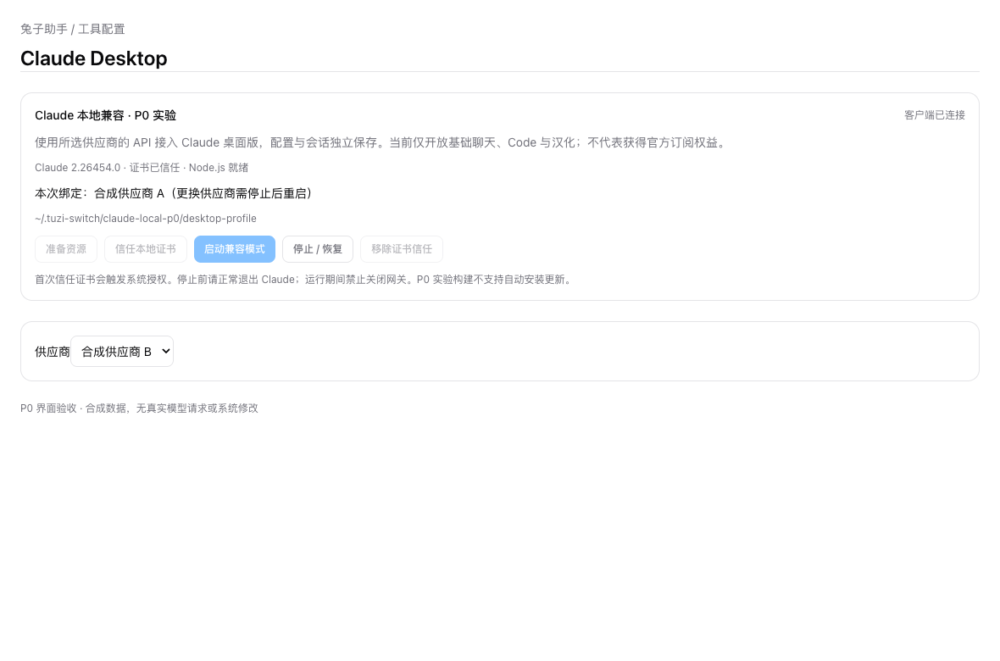
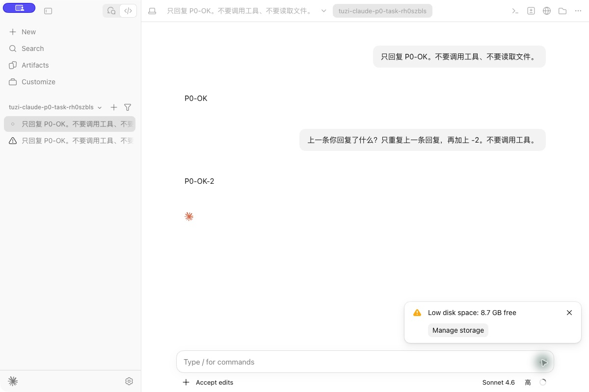
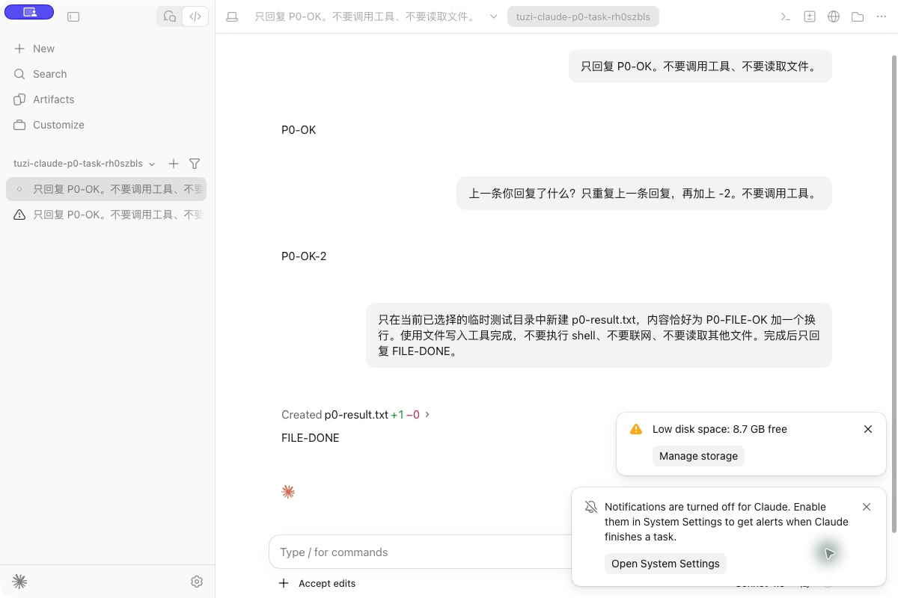
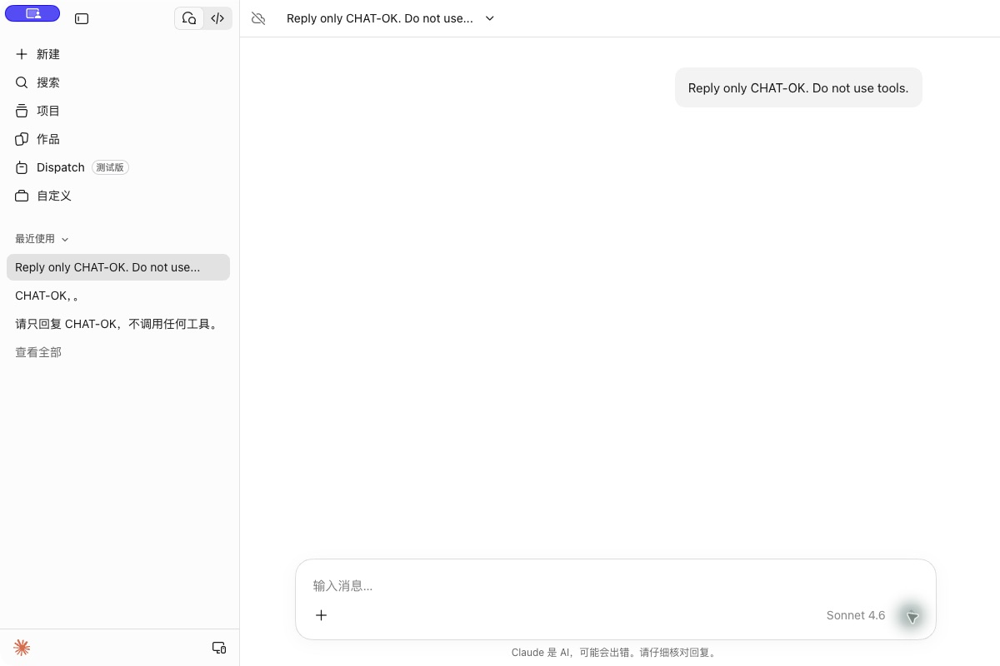
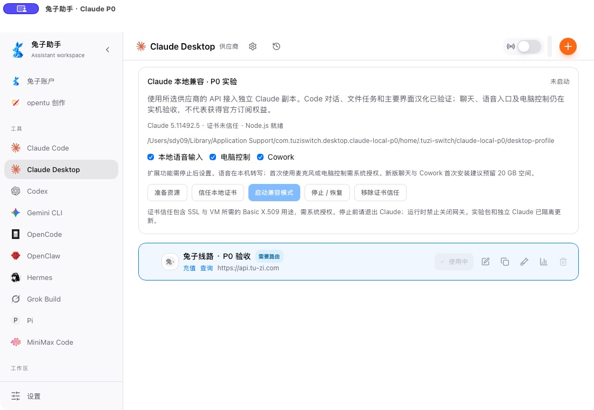

# CL-LOCAL-P0：B 方案首版实现与验证

本轮按用户选择实施“嵌入核心，复用兔子网关”。Claude 5.11492.5 独立副本与更新隔离、Code 多轮/文件任务/重启恢复、主要界面汉化已实测。新增可选语音、电脑控制与 Cowork 设置，语音模型下载和本地转写服务已通过。**全流程尚未验收完成**：普通 Chat 已越过 VM 安装及提示词初始化问题，当前被 VM 证书信任阻断；语音界面方案及 CA 补充 Basic X.509 信任待用户选择。下方首轮与新版初次结果均为历史时点，最新记录见“全流程继续验收”。

## 工作区与边界

- 分支：`codex/claude-local-p0`；基线 `6a7df853`。
- 独立工作区：`/Users/sdy09/Documents/ChatGPT/tuzi-claude-local-p0`。未修改“完善桌面端自动更新”工作区。
- 核心来源：ClaudeMom `ec627dbdc2e94ce1dbf5ccae8fc1018d903ac6fa`，`claude-local 0.1.3`。
- 只做本地开发、测试和本地实验包；无 push、PR、发布。首轮未安装系统证书或调用付费模型；用户后续明确同意继续实机验收，授权证书信任与少量模型测试，并选择复用“兔子线路”。本次进展见下方原生预检记录。
- 普通构建默认关闭核心。P0 特性强制隔离兔子数据；实验包使用 `com.tuziswitch.desktop.claude-local-p0`，不会自动导入正式版的供应商或凭证。

## 已实现

| 模块 | 行为 |
|---|---|
| Claude 配置入口 | 实验面板：准备资源、信任证书、启动、停止/恢复、移除信任；中英日文案齐全 |
| 网关接入 | 核心 → 专用令牌与路径 → 兔子原有适配器 → 指定上游 |
| 绑定 | 固定供应商、凭证、模型映射快照；供应商编辑或切换不会使运行中的会话漂移 |
| 模型映射 | 复用既有 route；Direct 仅在内存克隆上补明确模型映射；未知模型拒绝，不默认宣称 1M |
| 隔离 | 独立 Desktop / Code 目录；不共享、导入、合并个人会话；禁止符号链接配置写入 |
| 生命周期 | 操作锁、跨进程目录锁、启动意图记录、失败后显式恢复；正常停止不强杀用户任务 |
| 共享网关 | 活跃会话阻止关闭/改配置；释放绑定后网关继续运行；旧令牌失效 |
| 更新与退出 | 原生重启前检查；普通退出被活跃会话阻止；P0 包禁止自动安装更新 |
| 传输与统计 | 复用流式、转换及取消链路；Claude Desktop 转换响应的消费归属修正为自身应用类型 |



上图使用真实组件与模拟 IPC，展示已绑定 A 后把页面供应商改为 B，当前会话仍提示绑定 A。它是界面测试，不是实际登录成功截图。

## 操作流程

1. 构建/打开独立 P0 包，在 Claude Desktop 中手动配置测试 API 供应商，填好模型映射或明确的默认模型。
2. 点“准备资源”，验证并复制官方签名 Claude 到独立版本目录，写实验资源并生成本地 CA；点击“信任本地证书”才会请求系统授权。
3. 关闭所有 Claude 窗口并退出 Claude，点击“启动兼容模式”。当前仅允许 macOS / 已验证的 Claude 5.11492.5 独立副本，Node.js 需支持 fetch 和 WebSocket；其他版本须重新验证。
4. 停止前先正常退出 Claude，再点“停止 / 恢复”。既有会话与配置保留，网关不会随之停止。
5. 如有异常中断，重开实验包后先恢复。无需且不能自动沿用旧会话令牌。

## 新字段与兼容

没有新增供应商持久化字段或改变 Direct / Proxy 枚举。未知上游上下文窗口不显式声明；核心仍有 200k 协议默认值，因此长上下文兼容性需要单独实测。首轮 P0 固定关闭高级能力；用户要求继续跑通全部流程后，新增自有 `options.json` 的可选开关，旧用户及缺失字段仍默认 false。未把上游默认 `ultra` 当成产品权益。

自有 `session.json` 的 `schemaVersion=1`，含 `phase`（starting/running）、`providerId`、`providerName`、`claudeVersion`；无凭证。缺文件表示未运行；文件残留或不可解析且无核心进程表示需要恢复；停止成功后删除。配置根目录运行期间固定，修改兔子目录设置不能绕过旧会话检查。

IPC：`get_claude_local_status`、`claude_local_action`。未启用特性时状态仅返回 `enabled:false`，动作明确拒绝；不会初始化目录、核心或证书。启用时包含 `recoveryRequired`、`boundProvider`、`profileDir` 和核心状态。前端类型、禁用条件、中文/英文/日文提示及测试已补齐。

## 验证结果

环境：macOS arm64，Claude 2.26454.0，Node 24.14.0，pnpm 10.33.0，Rust 1.95。测试凭证均为合成值，数据库为内存库或专用测试 HOME。

| 验证 | 结果与范围 |
|---|---|
| 核心单测 | Rust 57 项与严格模型路由 JavaScript 1 项通过，含独立配置字段保留、拒绝符号链接、LaunchServices 参数与既有核心回归 |
| 原生定向测试 | `local_` 18 项通过，其中 3 项为本次 P0 测试；另有既有 Claude Desktop 配置 11 项通过 |
| 真实本机 HTTP 链路 | Node 核心 → 兔子网关 → Mock 上游；多轮、tool_use/tool_result、SSE、取消传播、未知模型、无效令牌、Origin 拒绝、错误不重试、绑定不漂移、令牌不泄漏上游、撤销旧令牌通过 |
| 网关生命周期 | 活跃会话下 stop / restore-stop / exit-stop / update_config 被拒绝，端口不变；释放后共享网关继续运行，通过 |
| 前端测试 | 5 文件共 23 项通过，含面板、受控重启、更新会话、更新提醒及既有供应商控件 |
| 浏览器 | Chromium 合成流程、恢复状态、供应商切换、620px 英文窄窗口检查通过；截图已目视检查 |
| 真客户端目录隔离 | 空白 profile 成功生成运行文件；检查范围内个人配置摘要一致；受管测试进程已退出，未安装 CA、无模型调用 |
| 编译 | 默认 / P0 原生检查及前端类型检查通过；两阶段 renderer 构建通过；macOS arm64 独立 Debug app 打包通过，bundle identifier 已核对 |

真客户端隔离证据见 [报告](attachments/claude-local-p0/isolation-report.json)。检测范围是 Claude/Claude-3p 的 `claude_desktop_config.json`、`configLibrary` 与 `~/.claude/settings.json`、`~/.claude.json`；不是对整个 HOME 或系统钥匙串的全盘证明。该探针使用拒绝连接的本机代理，验证目录启动，不证明登录、模型对话或 Code 执行。

关键实测发现：签名发行版会忽略 `CLAUDE_USER_DATA_DIR`，仅传环境变量的探针失败；增加 `--user-data-dir` 后通过。代码保留显式 `open --env` 传参，同时使用验证过的目录参数。没有修改 Claude 安装包或签名，也没有伪造开发测试授权。

## 复现与交付

```sh
# 使用 Rust 1.95；构建产物只留在本工作区，不安装或发布
scripts/build-claude-local-p0.sh

# 原生合成验证，指定全新的测试 HOME
CC_SWITCH_TEST_HOME=/tmp/tuzi-p0-test-home cargo test --manifest-path src-tauri/Cargo.toml --features claude-local-poc --lib local_ -- --test-threads=1

# 仅当本机 Claude 已退出时，显式执行空白目录探针
python3 scripts/qa/claude-local-isolation.py --run \
  --app "<P0数据根>/desktop-app/5.11492.5/Claude.app" --expected-version 5.11492.5
```

首轮实验包留档（当前包摘要见新版结果 JSON）：`src-tauri/target/debug/bundle/macos/兔子助手 Claude P0.app`，独立本地 macOS arm64 Debug 包。首轮 SHA-256：`69601e0e57c524826d82eda7e8e4beaf66428d93d3f6a75f83221abd140773b9`。入口代码见 `src-tauri/src/claude_local_integration.rs`、`src-tauri/src/proxy/local_session.rs`、`src/components/proxy/ClaudeLocalPanel.tsx`。上游来源及补丁见 [TUZI-PATCHES](../../src-tauri/vendor/claude-local/TUZI-PATCHES.md)，决策见 [ADR-022](decisions/0022-claude-local-p0.md)。

## 继续实机验收：原生预检

2026-11-16，用户答复“是，继续”，并明确选择复用当前“兔子线路”。已打开独立 P0 应用，以原生界面完成“准备资源”和“信任本地证书”。界面显示 Claude 2.26454.0、证书已信任、Node.js 就绪；系统 `security verify-cert` 对自有证书验证成功。证书当前保留在本机信任范围内，尚未执行移除。

只读核对正式版配置发现：没有 Claude Desktop 供应商，Claude Code 当前供应商 `tuzi-route` 的 `ANTHROPIC_AUTH_TOKEN` 和 `ANTHROPIC_API_KEY` 都为空。没有将其他账户或工具的凭证混用为测试 Key。用户已在实验版界面内填写 Key、将地址设为 `https://api.tu-zi.com` 并添加“兔子线路 · P0 验收”。模型为 `anthropic/claude-sonnet-4.6`，使用 Anthropic Messages 映射，1M 未勾选。

首轮兼容会话成功启动并绑定指定供应商，但 Claude 页面提示 `assets-proxy.anthropic.com` 资源加载失败。定位到内嵌 API 模板使上游进入线上 SPA / CDN 路径，未使用安装版本的网页资源。已修正隔离严格模式，使其固定使用本机安装包页面与静态资源，同时保留模板 API 行为；新增模板存在场景的 TLS 回归，确认页面和 CDN 资源无需出站请求。Node 回归共 27 项通过。首轮 Claude 与兼容服务均正常退出，运行标记已清除；数据库模型请求数为 0。

在该首轮时点，登录、文本多轮和 Code 文件任务尚未验收。系统截图接口报 `SCStreamErrorDomain -3811`，当时未取得截图；新版测试截图已恢复，见下方真实画面。初始预检证据和个人配置摘要基线见 [native-preflight.json](attachments/claude-local-p0/native-preflight.json)，其中 Key 缺失和未启动状态仅表示该文件记录时点。

## 新版适配与真实验收（2026-11-16）

旧客户端自动更新器在测试过程中将 `/Applications/Claude.app` 从 2.26454.0 升至 5.11492.5。此前 profile 隔离不涵盖安装包，已向用户说明；用户明确选择“继续适配当前版本并隔离更新”。

三层更新隔离：

1. Host 新增可选 `isolated_app_path`，默认 None 保留上游行为。P0 固定副本目录；准备/启动时验证官方签名、团队和版本，临时复制后原子提升。状态轮询不复制，不自动接受其他版本或损坏的副本。
2. 新版签名客户端忽略旧配置文件顶层的禁更新字段，实际读取自有 `desktop-profile-3p/configLibrary` 的所选条目。写入 `disableAutoUpdates:true`，保留其他字段、校验 UUID 与索引、拒绝符号链接。原生日志明确显示 `Auto-updates disabled by enterprise policy`。
3. 严格隔离代理对 `/api/desktop/<platform>/<arch>/<type>/update` 返回 204；Code 运行组件下载不被该规则阻断。

新版探针和真实测试结束后，原安装包、独立副本及检查范围内个人配置摘要均未变。原生日志仍在共享 `~/Library/Logs/Claude`，不宣称全 HOME 隔离。证据见 [新版探针](attachments/claude-local-p0/isolation-5.11492.5.json)。

| 实机项目 | 结果 |
|---|---|
| 本地模式进入界面 | 无需 Claude 账号，官方签名独立副本启动成功 |
| 模型映射 | 旧 ID 返回 400；只读模型列表核实后使用 `claude-sonnet-4-6` |
| Code 短回复 | 真实返回 `P0-OK` |
| 多轮上下文 | 下一轮真实返回 `P0-OK-2` |
| 文件工具 | 临时目录创建 `p0-result.txt`，实际字节为 `P0-FILE-OK\n`；返回 `FILE-DONE` |
| 普通 Chat | 首轮报 `VM_DISK_SPACE_INSUFFICIENT`；移除 Cowork 能力声明后仍进入 `/cowork/local_*` 并停留 Loading，不列为通过 |
| 汉化 | 新主界面仍有大量英文，现有汉化未完整生效，不列为通过；未保留无效的新增词条补丁 |
| 统计归属 | 首轮 4 个成功 SSE 请求归到 `claude`；修复后真实返回 `P0-FINAL`，对应成功记录为 `claude-desktop`。历史测试记录不改写 |
| 正常退出 | Claude 正常退出后停止兼容服务，运行 marker 清除 |






完整资源核查确认 5.11492.5 附带 `ion-dist.asar`（208001845 字节、buildId `spa-dev`）；旁边解包目录中的提示页不代表全部资源。核心优先读取 ASAR 固定网页壳与资源。新版 Chat 与汉化仍须按实机结果逐项适配，不以资源存在或单测通过代替验收。

最终 Debug 包已重建并打开核对，SHA-256：`90839f6636866a3a7d1d114cc549ef7811b2c37652d74917a4262b2295c4e409`。最后一次模型实测后仅调整界面范围说明并移除无效的新增翻译，两个包的摘要分别保存在结果 JSON 中。

新增回归：核心 Rust 59 项、Node 30 项、宿主 `local_` 19 项通过；宿主 HTTP 测试覆盖成功 JSON 与 SSE 的 Desktop 统计归属。SSE 测试使用真正的流式响应与独立消息 ID。真实证据见 [新版原生结果](attachments/claude-local-p0/native-5.11492.5-results.json)。本地费用记录为 0 不等于免费：本地未匹配模型定价，线上账单未核对。CA 仍受信任，无 push、PR 或发布。

## 未完成与下一步

1. 继续适配新版普通 Chat 和完整汉化。已完成的 Code 与隔离测试不代替这些验收；实验入口已同步展示实际验证范围。
2. 继续验证 CONNECT/TLS 边界。专用网关令牌不等于整个兼容代理都已具备逐请求认证；当前仍不适合正式默认开放。
3. 语音、电脑控制、Cowork 正在本轮继续实现与实测，当前结果见下方；后台模式、Windows、内置 Node 发行和完整更新事务尚未验收。
4. 确认上游 AGPL 核心的联合分发处理后，才讨论默认开启、合入发行分支与发布。

本地回退：正常退出 Claude，停止兼容会话，按需移除其 CA 信任，退出实验包。专用 profile 保留供恢复；正式版数据与原更新工作区不需要回滚。不要在会话活动中删除目录或切换回无此功能的构建。


## 全流程继续验收（2026-11-16，进行中）

用户要求“所有流程跑通”，并授权清理本机磁盘。仅清理可再生成的 Go/Rust 编译缓存、旧构建实验缓存、已完成下载的临时分片和自有 VM 压缩缓存，保留源码、正式数据与解压后的 VM 镜像。清理为 VM 安装腾出空间，但安装及编译仍消耗磁盘；不得把累计清理量当作当前可用空间。P0 构建脚本默认关闭 Cargo incremental，避免再次占用约 4 GB。

| 项目 | 最新实测与结论 |
|---|---|
| 汉化 | 修复 catalog revision 格式，从 `1.1.1` 改为新版接受的 `1.1`，补齐 40 条新版 ID；侧栏、新建、开始任务、作品等已显示中文。并非所有动态文本全部翻译 |
| 选项保存 | 语音、电脑控制、Cowork 默认 false；显式启用后重启保留；运行期间不可变更；缺文件和旧字段安全默认，坏 JSON/符号链接拒绝 |
| VM | 真实下载并安装 bundle `072b6cbfe74f428a98bd86035f83b322b369d1f1`；VM 启动、SDK 2.1.325 安装成功。VM 成功不等于聊天成功 |
| Chat 初始化 | 本地 bootstrap 原先缺少 `cowork_system_prompt.value.prompt`，导致前端等待；补充自有最小提示词与 system_prompts 接口后已能创建会话 |
| VM 出站 | 原先继承系统代理，绕过本地兼容层；新增每次启动写入自有 `egressProxyUrl`。原生日志确认 admin-pinned proxy，Node 确认收到 `api.anthropic.com` CONNECT；仍仅监听 127.0.0.1 |
| Chat 当前阻塞 | VM 返回 TLS BAD_CERTIFICATE；独立只读 Security 探针：同一 CA 的 SSL 校验 true，Basic X.509 false / -67843。拟补充 `ssl` + `basic` 两种明确策略，等待用户同意及系统确认；未关闭 TLS 校验 |
| 中断 | 页面“停止回复”能终止失败重试，显示回复已中断；无成功 Chat 回复，不标为通过 |
| Code 恢复 | 恢复已有会话，真实 Read 临时文件，返回 `P0-FILE-OK`；本轮未改个人会话 |
| 语音下载 | 原生界面下载约 240 MB 模型，进度实际变化；固定大小与 SHA 校验成功后才可启用 |
| 语音服务 | 真实本地 SenseVoice 模型经 WebSocket 转写合成音频成功；输入 `The local voice input test is successful.`，输出 `The local voice In test is successful.`，有词语识别偏差 |
| 语音 UI | 新版原生入口还要求 gateway + interactive 认证及票据协议，当前不会显示麦克风。已提出“本地按钮”与“适配原生入口”供用户选择；后台转写不代表麦克风实测通过 |
| 电脑控制/Cowork | 开关及后端能力已接入；真实文件任务、权限与电脑交互仍待 Chat/VM 证书修复后验收 |
| 停止与恢复 | Claude 未退出时拒绝停止；正常退出后停止服务，session 与 dictation-helper receipt 删除；共享网关保留 |



新增选项为自有 `options.json`：`voiceInput`、`computerUse`、`cowork`，统一 serde 默认 false。IPC 补齐 `options`、`voiceModelReady`、`voiceDownload` 与 enable/disable/prepare_voice 动作；前端类型、中英日文案及回归同步更新。模型位于隔离根 `speech-to-text/sensevoice-onnx`，不借用个人 Codex 模型缓存。

语音 helper 有退出通知和 receipt 撤销；新会话使旧令牌失效，线程/运行时启动失败不留下 ready 标记。真实构建链接 `sherpa-onnx-sys 1.13.8` 官方预编译库，没有跳过原生链接。已通过核心 79 项、Node 64 项、宿主 `local_` 21 项、前端组件 6 项和类型检查；最新补充证书策略的两阶段前端构建与 macOS arm64 Debug 整包构建已成功；证书信任变更尚未执行。阶段证据见 [全流程进展 JSON](attachments/claude-local-p0/native-full-flow-progress.json)。

CA 拟议修复只在显式“信任本地证书”动作中执行，使用当前用户登录钥匙串，保留 SSL 并追加 Basic X.509 策略。新版状态检查和启动门禁需要两者通过。移除信任修正为 user 域（原命令误用 admin `-d`），并分别验证两种策略已撤销；本轮尚未实机执行此移除操作。

下一步须取得真正的 Chat 首轮与多轮回复，再做附件、Cowork 指定临时目录读写、电脑控制指定测试窗口、麦克风输入和异常恢复。所有未通过项仍保留，不以开关存在、模型文件齐全或构建成功替代实测。




## 发布准备补充

2026-11-16 用户提出 11 月 17 日可发布的目标。已补齐内置 Node 运行时及默认构建兼容检查，并修复混用测试框架导致的全量回归失败；当前发布阻断、平台选择与正式版集成门槛见 [CL-LOCAL-RC-01](2026-11-17-claude-release-readiness.md)。仍未取得新增 CA 用途授权，不将本地调试包视作正式候选。
