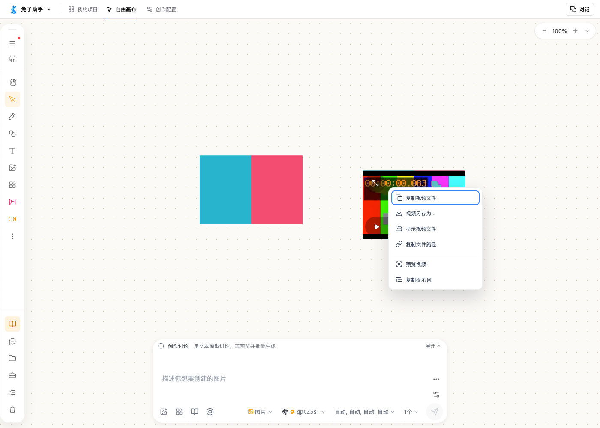

# UC-VIDEO-FILES-01：视频右键文件操作

日期：2026-11-16。分支 `codex/fix-video-file-actions`，基于已整合画布生成卡片的 `6484dd67`。本轮用户要求修复视频缺少打开文件位置、复制等操作，仅本地实现与验证。

## 问题和行为

此前视频右键只提供另存为、预览、复制提示词，图片已有的文件定位没有接入视频。

现在视频菜单提供六项：复制视频文件、视频另存为、显示视频文件、复制文件路径、预览视频、复制提示词。文件复制使用系统文件剪贴板，可以供支持文件粘贴的应用使用；路径复制是文字。所有操作绑定右键实际命中的视频，不操作旧选区或播放器下方的图片。

缓存或生成视频未必有可展示的原始磁盘路径，沿用此前图片“自动保存副本并定位”的方式：将原始视频字节保存到系统视频目录下的 `兔子助手`（macOS 通常为 Movies/兔子助手），再定位或复制。路径指向这个可复用副本，不声称是最初导入文件的位置。SHA-256 内容命名，重复操作复用，删除后重建；用户改过的副本保留并另建，不自动清理。

优先读取已有缓存；缓存缺失时提示找回结果，不使用封面、不调用生成 API。原生按媒体内容识别 MP4/WebM/Ogg，继续使用现有 128 MiB 限制。没有原生能力的浏览器宿主禁用这三个文件动作；原有保存、预览和提示词操作保留。

## 实现边界

- 宿主增加可选 `videoAction` 桥接字段，未连接账户时同样可用；旧接入方不需要补字段。
- `creative_video_action` 仅允许主窗口、限定三种动作和有界二进制，不接受任意路径、远程地址或账户凭证。
- 原生复用图片的原子写入、副本复用和符号链接保护；剪贴板使用现有 arboard 的文件列表接口，没有新增依赖。
- 无数据库字段、服务端 API 或账户契约变更。保留上一任务的画布卡片集成。

## 验证

- 宿主类型检查通过；媒体桥接/账户桥接 50 项通过。
- 创作视频菜单/下载工具 40 项通过，包含缓存、失效、大小边界、能力缺失、取消、错误与命中目标。
- Chromium 和 WebKit 各 17 组浏览器回归通过，零 pageerror：六项菜单、视频原始字节抵达桥接、预览/播放、拖动、缩放、平移、叠层命中、图片旧菜单。
- 浏览器使用本地合成 MP4 与 IPC fixture；不将这些结果当成真实 OS 文件操作证明。
- 创作模块和宿主前端构建通过。保留已有 chunk 体积、Sass 和浏览器数据过期提示。
- 上游固定源补丁重建通过：1524 个原始文件、143 个本地文件，总计 1667 个文件。
- Rust 原生媒体 4 项通过（另有 1 项真实剪贴板测试单独按需执行）；拒绝错误页面/非视频类型和无效动作、保留原始字节、副本重复使用/删除重建/修改保护。
- 显式运行 Mac 原生系统剪贴板测试 1 项通过：真实写入视频文件列表，经另一个剪贴板实例读回，核对路径及原始文件字节；再写入文字路径并读回，覆盖中文/空格文件名。该测试使用临时合成视频，结束清空测试剪贴板；不等同于 Finder 中人工粘贴。
- 图片共用文件工具 9 项通过，包含符号链接保护、原子写入、修改保护和大小/格式校验。Rust 合计 14 项通过；初次 debug 编译因本机空间规划中止，随后使用 release 测试构建完成验证。



## 交付边界

当前尚未覆盖 `/Applications/兔子助手.app`，没有构建发布用安装包、推送、PR 或更新线上下载。此功能需装入后续新包才会出现在已安装应用里。没有新增付费模型请求；Windows/Linux 原生复制粘贴和 Finder/Explorer 的整包点击流程尚未验收。

## 可复现命令

```sh
pnpm typecheck
pnpm test:unit tests/lib/creative-media-save.test.ts tests/lib/creative-account-bridge.test.ts
pnpm test:creative CanvasImageContextMenu.test.tsx download-utils.test.ts
pnpm build:creative
pnpm exec vite build
cargo test --release --manifest-path src-tauri/Cargo.toml --lib creative_media::tests -- --test-threads=1
cargo test --release --manifest-path src-tauri/Cargo.toml --lib creative_images::tests -- --test-threads=1
# 显式运行，实际修改系统剪贴板（不属于默认 CI）：
cargo test --release --manifest-path src-tauri/Cargo.toml --lib creative_media::tests::real_video_file_and_path_clipboard_roundtrip -- --ignored --exact --test-threads=1
python3 scripts/refresh-creative-provenance.py --source-repo /tmp/tuzi-opentu-pinned-source.git
```

浏览器使用 `tests/visual/canvas-media-context-menu.cjs`；`CREATIVE_QA_BASE_URL=http://127.0.0.1:5209`、`PLAYWRIGHT_MODULE=/tmp/tuzi-seedream-qa-tools/node_modules/playwright`，分别运行默认 chromium 与 `CREATIVE_QA_BROWSER=webkit`。结构化检查记录保存在相邻 `video-file-actions-evidence` 目录。
