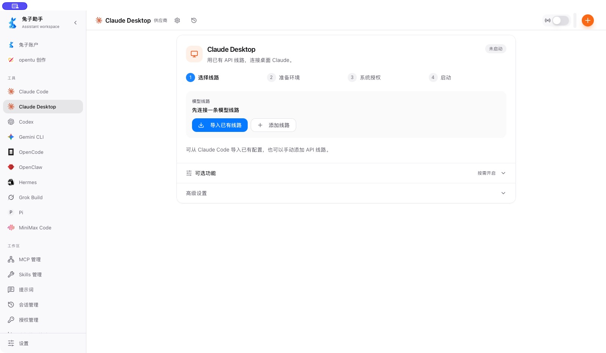

# CL-LOCAL-UI-02：Claude Desktop 简洁启动面板

用户查看已安装的测试版后选择 B：整合成简洁启动面板。当前仅本地修改和测试安装，不推送或发布。

## 实现

- 将兼容设置和供应商空状态合成一张卡片。首次使用提供导入已有线路、添加线路；配置后直接选择当前线路。
- 选择线路、准备环境、系统授权、启动四步按已有状态推进；一次只强调当前下一步，不自动导入、信任证书、启用扩展或调用模型。准备与系统授权仍是两个明确动作。
- 运行时显示实际绑定线路以及停止入口；恢复状态不依赖当前选择的供应商。未完成线路切换、外部 Claude 仍运行、运行组件缺失时不能启动。
- 语音、电脑控制、Cowork 放入默认折叠的可选功能，仍受原有能力和会话锁约束。Linux 的两个不支持项保持禁用且无语音下载按钮。
- 目录、版本、证书详情、非运行期说明和环境复查放进高级设置；操作错误保留在主面板。当前会话中不可编辑线路或更改证书。
- 原有 ProviderList 保留在线路管理中，账户深链定位可展开；不启用兼容核心的构建保留原供应商页面。其他工具的 ProviderList 属性和行为不变。
- 三语言字段齐全，无数据库迁移、原生接口或供应商凭证字段变更。

运行中只提供已实现的停止操作，没有用重复启动冒充“打开 Claude”。正式的窗口唤起功能尚未添加。

## 验证与边界

- 类型检查通过；面板 13 项、ProviderList 7 项、应用集成 24 项，共 44 项通过。
- CUA 浏览器模拟覆盖 Windows 导入、准备、显式授权、启动状态；Linux 英文深色下折叠功能和禁用项；实际 CSS 内容宽 600 / 826 时无横向溢出。模拟不代表 Windows 或 Linux 实机验收。
- 完整前端和 Mac ARM 原生测试候选构建，使用 `CARGO_PROFILE_DEV_DEBUG=0` 减少可再生成调试产物；不改变功能特性。构建结果及最终程序摘要见对应证据。
- 本机原生界面确认新面板、可选功能和添加线路表单；打开空表单后取消，没有导入真实凭证、改变证书、启用功能或新增模型请求。
- 仍为未签名 1.6.2 测试版。普通聊天、Cowork、语音、电脑控制的完整功能和其他平台原生验收边界不变。

## 本机交付

最终版本已安装并打开真实 Claude Desktop 配置页，程序 SHA-256：`4d9cfca4d52814cea04c61be6b1e0357fa15c917e5da0ed8aee1d628a44b614a`。旧测试程序和配置备份在 `/Users/sdy09/Library/Application Support/Tuzi Local Backups/claude-ui-20261117-104759`；11 月 17 日首次替换前的完整正式版本数据备份仍保留。

证据：[结构化记录](attachments/claude-local-p0/setup-ui-2026-11-17.json)。

