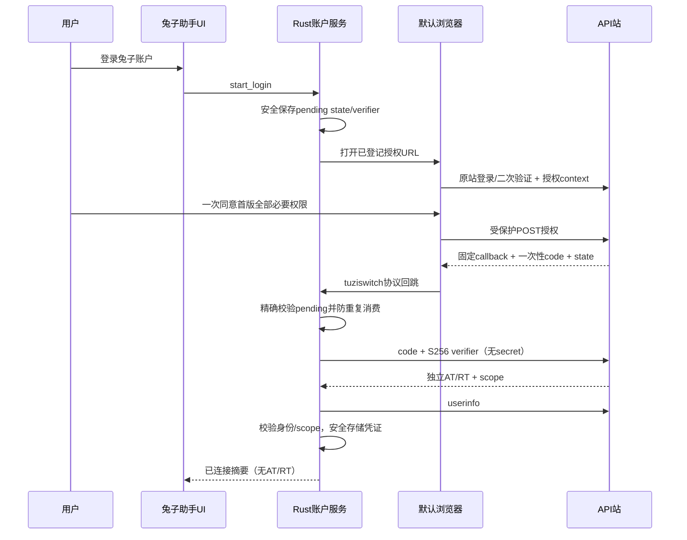

# 技术实施方案

基线 `TA-AC-1.5-B3`，契约 `desktop-v1.1`。2026-10-13 T01技术冻结，以下尚未实现；产品见ADR-001，技术见ADR-002。保留 React/Tauri/Rust 与 Go/Gin/GORM 现有架构，不替换状态管理、计费引擎或工具配置系统。

## 模块与职责

| 端 | 现有接入点 | 新增/适配职责 |
|---|---|---|
| 客户端UI | src/App.tsx、AppSwitcher、SettingsPage、现有providers/forms | 账户导航和页面、连接摘要、原生资料、现有创建表单预填、网页入口 |
| 客户端账户请求 | src/lib/api、src/lib/query、errorUtils | 建议新增 account 领域目录及账户query key factory；结构化错误、能力/权限映射、只读缓存 |
| Rust认证 | commands、lib.rs、deeplink、proxy/http_client | 建议新增独立 tuzi_account/service+commands；pending、回调分流、TokenStore、token lifecycle、受信HTTP与数据DTO |
| Rust配置 | services/provider、config、database/backup、工具专有config模块 | 复用保存/切换，追加账户来源预填和变更/备份边界；新关联表只存非秘密元数据 |
| API认证 | controller/model/oauth_provider、middleware/auth、router/api-router | client注册查找、public/confidential区别、scope映射、连接/安全事件/限流/清理 |
| API业务 | controller/token/user/log/usedata/consumption_stats/pricing/perf_metrics | 显式desktop权限上下文及白名单DTO；安全复用model/service，禁止简单透传管理视图 |
| 网站 | web/src/pages/OAuthAuthorize、个人资料区 | 可信名称/权限一次确认、账号切换/回跳恢复；本人桌面连接列表及撤销 |
| 数据/运维 | model/main、cmd/db-migrate、现有任务/锁机制 | 增量小表/字段/索引迁移、有界清理、独立开关和发布说明 |

以上新目录名称是实施建议，接口、scope、共享类型已由T01冻结后再并行。新依赖（如安全存储库）只能在后续授权编码中引入，本轮未改依赖。

## 认证与令牌生命周期

建议服务内部状态：disconnected → authorizing → exchanging → verifying → connected；connected可进入refreshing、offline或invalid；任何主动取消/退出/换号递增generation并进入disconnected。UI可以合并展示状态，但不能丢失错误原因。

授权配置集中管理auth_origin/client_id/api_origin/scope_version/record_version/受信网页目标。只通过正式版本或受控配置更新；不能通过任意深链接把Token发送目的地改走。当前来源为API站，记录实际userinfo sub/user_id；不虚构OIDC issuer。未来更换认证来源需要验证映射且可要求重连，工具配置保留；不自动按邮箱/同数字ID合并。

pending在打开浏览器之前生成，包含state、verifier、client、回调、开始/截止、generation和一次消费状态；安全存储短期记录让应用被浏览器冷启动后可恢复。无pending、错state、重复query、错误路径、过期、旧generation均拒绝；前端不接收原始callback。lib.rs所有入口（on_open_url、single_instance、RunEvent）统一分流，保留v1/import功能。若用户取消后才回跳，服务不得恢复已取消连接。

### 系统安全存储

- 使用macOS Keychain、Windows系统凭据/受OS保护存储、Linux Secret Service等可靠实现，T04记录最终库与平台能力。现有工具JSON存储不作为兔子账户存储。
- 命名空间含认证来源、client_id、api_origin、业务user_id/连接ID、record_version。当前版本每站点只一个活动连接；不因此新增多账号产品。
- 原生持有AT/RT和短期verifier；前端仅得到连接ID、身份摘要、权限/能力、到期状态及脱敏错误。模型Key在用户主动reveal时可短暂进UI表单，但不进通用query缓存或持久存储。
- 安全存储不可用/锁定/写入失败显示可恢复错误，不能降级普通文件。新凭证若已签发但落盘失败，尽力撤销且不宣布已连接；撤销失败明确未知结果。
- SQLite、SQL导出、备份、WebDAV仅保存允许的非秘密本机元数据；账户关联建议排除跨机同步并按当前身份验证，避免导入旧备份恢复旧授权。诊断/崩溃/IPC日志使用字段allowlist。

### 串行刷新与不确定结果

每连接一把异步锁（single-flight）；等待者在拿锁后重新检查当前token generation，复用新AT。请求读到旧AT收到401时再次检查是否已轮换，避免二次无谓刷新。AT最长30分钟；RT每次成功轮换闲置7天；family绝对30天且AT/RT不能越过绝对期限。

原生在发出refresh前持久化“refresh in-flight”状态；收到成功先安全存新AT/RT与版本再释放请求。失败分类：

| 故障 | 恢复策略 |
|---|---|
| 确认未发出请求的离线/本地校验失败 | 保留旧连接，退避后可重新尝试 |
| 服务端明确invalid_grant/已撤销/重放 | 停止刷新，清旧授权展示，要求重连 |
| 请求已发送但响应丢失/超时 | 结果不确定，禁止重用旧RT重试；当前版本采用安全失败并重连；网站可撤销遗留连接 |
| 已收到新token但安全持久化失败 | 尽力用新RT撤销family，断开并提示；不能继续旧RT |
| 应用崩溃重启仍见in-flight journal | 不认定旧RT未被消费，进入需重连状态 |
| 并发退出/换号发生在刷新或换码中 | 旧generation结果不提交本地；若拿到旧generation新凭证尽力撤销对应旧连接，不能写入新账号 |

不采用“宽限重放”作为默认优化；将来若引入幂等刷新票据/恢复机制需单独ADR、契约和安全测试。当前安全失败方案符合v1.5无法恢复则重授权边界。只读业务请求401最多一次恢复重发；非幂等创建Key/资料写超时不自动重放。

### 退出、切换与安全事件

本地先停止账户读取、递增generation、清前端缓存/内存Key/未保存预填；在线尽力撤销当前family，再清安全存储，界面分别记录local_cleared与remote_revoked。离线或超时退出仍必须完成本地清理，不为了后台重试把RT另存普通队列；提示到网站撤销该连接。用户可通过网站查看本人连接并单独撤销。

改密/重置、禁用、删号都撤销该用户所有桌面family和未消费code；覆盖自助、管理员、邮件重置及实际账户状态修改入口。与并发授权/刷新必须通过事务锁/安全版本或等价机制协调；每次访问也检查连接状态和账号状态，不因长缓存延迟撤销。旧OAuth/网站会话的既有规则保持。启用账号后旧桌面family仍已撤销。删除账号后不得刷新出新Token。

## 请求、缓存与数据隔离

账户QueryKey建议：`['account', auth_source, client_id, api_origin, user_id, connection_id, generation, feature, filters, contract_version]`，模型目录另含pricing snapshot/schema版本。工具queries仍按现有app/provider工作，不全局清理工具状态。

Rust请求有超时和取消句柄，React Query使用signal驱动取消。账户切换先增generation → cancelQueries/取消原生旧请求 → removeQueries账户命名空间 → 清页面状态/选择/图表/剪贴板临时状态/预填 → 建立新身份。两端都检查generation，迟到成功、失败、后台回读和mutations onSuccess不能修改新账号。已经发送的服务端写无法保证取消：标记旧账号操作结果待核实，不把它显示成新账号结果。

默认按进入页面/用户刷新/返回网页触发请求，同过滤去重；首页多个卡片共享数据请求。页面隐藏暂停刷新、前后台切换加抖动；不秒级轮询日志/图表。重试只针对可重试只读错误，指数退避有上限且尊重Retry-After。timeout/staleTime/范围/频率按api-contract冻结；容量与灰度阈值仍由T21验证，不把技术初值当容量结论。

只允许当前仍有效授权的非敏感概要离线缓存；撤销/不可恢复失效不得展示旧授权缓存。账户只用内存缓存，不建立持久化离线账户数据库；进程重启离线且无数据时显示离线状态。401不是普通离线，403不是空列表，临时5xx不自动退出工具。

金额保留原始额度与元数据，UI统一格式化，按API实际币种配置显示；时间用Unix秒/毫秒字段区分，日期显示明确时区。总览“今日消费调用”使用服务端消费统计口径，异步延迟单独展示，不与失败请求数或本机代理次数混算。

## 工具预填、写入和脱敏

不新增独立配置向导。AddProviderDialog/ProviderForm增加显式创建预填上下文，区别编辑initialData；包括目标app、主站预设/协议/端点、模型候选、短期Key句柄或受控值、来源账户generation。只有选择目标并验证兼容后才reveal。

T15必须生成七工具能力矩阵：可否按现有主站配置创建、支持协议/端点、Key写入位置、预设来源、配置文件集合、备份/恢复及自动启用语义。Claude Desktop当前预设数组为空，不能照搬其他工具索引；可按现有表单能力适配；下表记录的新默认预设/端点仍需T15逐项核实，未验证时按钮应解释不支持，不能标已适配。

T01冻结的创建适配矩阵如下；这是源码可实施边界，**没有完成真实模型调用/平台支持验收**。T15逐项补实际write-set和备份证据，T20实测平台；不存在的预设必须新增明确标识，不能依靠数组序号。

| 工具 | 采用现有能力与主站端点 | 预填/写入与备份对象 | 完成门禁 |
|---|---|---|---|
| Claude Code | 现有主站Anthropic预设，https://apius.tu-zi.com | env的ANTHROPIC_BASE_URL/AUTH_TOKEN，清既有冲突API_KEY按原规则；Claude settings与provider DB/环境写集 | 保留原协议/路径；模型由可见兼容列表选，不把旧默认模型当保证 |
| Codex | https://api.tu-zi.com/v1，responses | auth/config TOML及provider独立envKey、provider DB | 多卡环境键隔离，不能写coding Key，不强改共享OPENAI_API_KEY |
| Gemini CLI | https://api.tu-zi.com，Gemini协议 | .env GEMINI_API_KEY/GOOGLE_GEMINI_BASE_URL、settings.json及provider DB | 多文件失败补偿，保留其他settings |
| OpenCode | 原预设为空；新增主站创建项，现有npm表单支持OpenAI Responses、chat兼容、Anthropic、Google | OpenCode JSON/JSONC provider配置、provider DB；按所选协议决定/v1或原根地址 | 仅显示账号模型同时满足端点与SDK能力的选项；不是任意模型通用 |
| OpenClaw | 主站codex-tuzi为openai-completions；claude为anthropic-messages，/v1 | OpenClaw JSON配置及provider DB，保留additive行为 | 不误改为responses；读实际live写集再备份 |
| Hermes | codex_responses或anthropic_messages，/v1 | ~/.hermes/config.yaml的custom_providers及provider DB；providers_dict保持只读 | YAML无关字段保留，原工具认证不替换 |
| Claude Desktop | 原预设为空；新增主站项接现有proxy模式；macOS/Windows原有支持，Linux此工具无现有支持 | 普通Claude配置、Claude-3p配置、configLibrary/{PROFILE_ID}.json与_meta.json、代理状态/DB按现有路径helper定位 | 不承诺未证实direct企业网关；代理Key与模型Key分开；Linux按钮明确不可用（不等于整个应用Linux不支持） |

平台路径不硬拼，复用src-tauri现有各工具path/config helper。写集在Rust保存计划阶段取得：存在文件字节/权限/哈希与不存在标记、环境项和provider/代理DB状态；备份在任何首次写/自动启用前完成。期间文件哈希改变则中止/提示冲突，不用旧备份覆盖用户新修改。跨文件/DB按操作日志补偿恢复，备份中模型Key按现有本地秘密保管与访问限制，不进入脱敏预览/遥测；账户OAuth永不入备份。

写前读取并展示脱敏diff；在首次可能写入环境变量、provider DB或live文件之前备份所有受影响对象。原子写只保护单文件，跨文件/DB需要操作记录与补偿恢复；失败不留下“保存成功”或错误当前供应商。备份失败阻止写入，恢复前检查用户期间是否另改文件，不盲覆盖新的用户修改。保留现有注释、未相关配置、MCP/skills/profile和工具OAuth。

Model Key工具运行保存遵循现有机制；OAuth不进入其中。Codex每卡独立envKey，不强行回到共享OPENAI_API_KEY，也不把前端新建和后端seed的名称硬合并。主站Key与Coding/GACCode创建路径分离。保存完成后仅记录真实来源 `{站点,用户ID,tokenID,app,providerID}`；既有未知来源显示“未关联/未知”，无需扫描/上传所有本地Key。

新的账户/订阅网页入口只用opener和固定HTTPS目标，不使用open_webview_with_key。允许改方案明确要求的Coding/GACCode查询URL；其他现有工具用量脚本/本机统计按现状保留。

## API 权限与业务适配

认证解析与业务授权分层：先按client验证AT/连接/用户，再建立可信desktop上下文，最后route级scope + owner + 业务能力检查。保留原UserAuth及session行为；不把desktop赋一个虚假普通role来全局改变用户，而在窄业务投影中显式 `desktop_self`（内部名称待定）。

- Key：新增窄路由、复用现有业务验证，验证读取、写、reveal分别控制；创建返回新Key边界保留；字段缺省不能清零既有高级配置。
- 账户/资料：白名单DTO，五字段PATCH，封闭未知字段。不能直接复用混合密码UpdateSelf入口。
- 日志：强制user_id，reuse普通脱敏逻辑后再投影摘要；以request_id和本人取详情，禁止管理渠道/原始内容。统计同一过滤集，self/stat按user_id收紧。
- usage：从LOG_DB持久化消费type2有界聚合，desktop无论role均禁止其他user/channel；缺watermark显示延迟未知。
- 定价/性能：识别OAuth并按业务账号资格返回可见分组/个人折扣，禁止管理员视图；带无效Bearer不能匿名降级；服务端缓存键含影响授权/价格的输入；客户端切号清snapshot及分组。
- capabilities明确协议支持/版本及站点开关；即使功能开关关闭也不能默许首版缺项正式发布。

## 数据库、清理与多实例

冻结结构、锁序、迁移及清理见下文T01落地规格；独立新小表，不更改旧OAuth code/token表，不顺带改余额、订单或日志大表。三库与实际MySQL验证仍由T21完成。

### T01落地规格：独立表与索引

列名是新迁移版本 `desktop-oauth-1` 的契约；时间列使用Unix秒BIGINT，用户ID跟随当前主库users类型，hash为64位小写hex，字符列按现有三库通用字符串/文本封装，布尔/JSON不使用只在某库可用的默认表达式。GORM model建表后须核对DDL，生产实际MySQL版本未核实。

| 新表 | 必需列 | 键/查询索引 |
|---|---|---|
| oauth_desktop_clients | client_id VARCHAR(191)、client_name、client_type=public、redirect_uri、trusted_auth_origin、trusted_api_origin、allowed_scopes文本、scope_version、code_ttl_seconds、access_ttl_seconds、refresh_idle_seconds、grant_absolute_seconds、authorize_enabled、refresh_enabled、business_enabled、created_at、updated_at | PK(client_id)；client_name仅展示，不作身份判断 |
| oauth_desktop_connections | id CHAR(36)、user_id、client_id、scopes文本、scope_version、status(pending/active/revoked)、approved_at、absolute_expires_at、last_refresh_at NULL、revoked_at NULL、revoke_reason NULL、updated_at | PK(id)；(user_id,client_id,status,approved_at,id)用于网站列表/用户撤销；(status,absolute_expires_at,id)用于清理 |
| oauth_desktop_authorization_codes | code_hash CHAR(64)、connection_id、user_id、client_id、redirect_uri、scopes文本、code_challenge CHAR(43)、created_at、expires_at、consumed_at NULL | PK(code_hash)；UNIQUE(connection_id)；(user_id,consumed_at,expires_at)安全事件；(expires_at,code_hash)清理 |
| oauth_desktop_tokens | token_hash CHAR(64)、connection_id、user_id、client_id、kind(at/rt)、scopes文本、created_at、expires_at、rotated_at NULL、revoked_at NULL | PK(token_hash)；(connection_id,kind,created_at)轮换/撤销；(user_id,kind,expires_at)审计；(kind,expires_at,token_hash)清理 |

对existing `users`、旧 `oauth_provider_*`、logs、orders不加列、不重建索引。外键约束不作为三库并发正确性的唯一保护；事务和应用验证必需。client登记行不是启动自动启用，迁移只建结构；安装/启用配置在获授权部署步骤受控完成。注册码、回调和scope必须与契约精确一致，不含secret。

### 事务与验证顺序

所有桌面批准、换码、刷新、撤销、安全事件采用主库事务，统一锁序：先锁users行并重读status，再锁connection行，再处理code/token行；不存在的用户或非启用状态拒绝。批准在事务内建pending connection及code，approved_at为绝对寿命起点；网站显示pending。换码在同锁序内验证client/redirect/S256、pending/未撤销/未过期及code未消费，CAS消费后建AT/RT并置active，失败整事务回滚。刷新锁住同一连接和旧RT；唯一轮换记录、新AT/RT签发和当前连接旧AT撤销提交同事务，旧RT的rotated_at是重放证据；重放撤当前family（不触动别的连接）。Access验证必须查token、connection、user状态，无跨请求正向授权缓存；敏感写在锁内重检。已开始但未完成的业务写在安全事件前后以事务提交顺序判定，T07并发用例检查边界。

自助改密、管理员改密/重置、邮件重置、禁用/删号相关入口都应调用同一安全事件函数，在**同一用户锁事务**内修改用户与撤该用户所有desktop pending/active连接、未消费code和AT/RT；若撤销失败，原安全变更不能静默提交。硬删除需先在事务内撤销并确保不能重建，之后物理删除/清理。普通桌面退出只撤对应connection；网站单连接撤销也不影响其他连接。旧网站/系统token/旧OAuth行为保持其已有策略。

首版拒绝刷新宽限期：请求已发而响应丢失、或崩溃见journal，客户端不能重用旧RT；断开、提示重连与网站手动撤销。AT单独撤销不撤family；RT用于退出。跨实例CAS/事务重试只能重做未外发的本地事务，不重复发已不确定的刷新请求。

### 迁移、限流与清理

T02新增 `cmd/db-migrate --desktop-oauth` **仅规划**入口，与旧 `--full/--oauth-provider/--fapiao/--capability/--taskrecover`互斥；`--desktop-oauth --apply` 才执行版本 `desktop-oauth-1`，其它旧模式/--apply行为不改。该模式只连接/检查main DB（旧CLI对oauth模式误要求log DB须修正此新入口），用 `InitDBWithoutSchemaMutation`、现有online lock/保护性planner做表/列/索引定义校验；存在但不匹配即中止，不自动改写。新库、旧库、失败重跑、重复执行及旧服务共存均要测试。启动不自动补新表；schema缺失时desktop能力不可用，旧服务继续。生产迁移须另授权，不以文档命令触发。

清理仅新表：每5分钟候选批500条、单次最多10批、运行预算30秒，使用现有主库全局锁租约/令牌围栏，按时间+主键游标；可暂停并有扫描/删除/耗时/失败指标。过期code及pending连接至少保留1天，**已轮换RT hash保留到family撤销或绝对到期后再加7天**，以继续识别重放；AT到期至少1天，所有token全部不可用且7天审计窗口后才删terminal connection。按连接终态判定，不因单个RT的expires_at清掉仍活跃family的重放证据。旧confidential表及其无绝对寿命family不由此清理器触碰。数值为技术初值，T21压测若须调整增ADR/契约记录。

独立桌面限流命名空间：授权5次/用户/5分钟、换码10次/client IP/分钟、刷新6次/connection/分钟、reveal5次/用户/分钟、业务读60次/用户/分钟、写20次/用户/分钟，统计/模型性能另10次/用户/分钟；429 Retry-After向上取整秒，分桶顺序先IP再连接/用户，旧限流桶不改。这是防滥用初值而非容量结论；账号总量/代理IP取值需按现有信任边界处理，不依赖客户端报IP。多实例需共享限流存储且T21实测；Redis是否存在未知，若多实例共享限流不可用则桌面请求503 fail-closed、保留撤销网站通道，不回退到各节点无界本地桶。单实例可用本地有界桶，部署条件必须核实。

客户端登记行的authorize/refresh/business三个布尔列初值全false。有效授权分别要求全局同名开关与该client列同时开启（逻辑AND）；灰度名单额外限制批准对象，不放宽任一开关。`desktop_authorize_enabled` 控制新批准/换码；`desktop_refresh_enabled` 控制刷新；`desktop_business_enabled` 控制N业务；`desktop_allowlist_user_ids` 控制灰度批准，不作为绕过权限。默认全关，schema缺失全关；停新授权不自动撤已签连接，若要止损同时关refresh/business或显式撤连接。revoke、网站连接删除、清理在业务关停时仍可用；旧OAuth总开关不作为desktop止损。能力接口在business关停时以503返回可识别不可用，不能假报全部true。开关状态及每个灰度账号/对应契约记录在进度，不保存真实凭证。

## 功能开关、发布和回退

desktop授权、刷新与业务开关及灰度名单按下文冻结规格分离。所有路径（authorize/token/refresh/API）依据明确状态返回可识别错误；撤销通道在停止发新授权/业务访问时仍应可用，清理仍可运行。不得关闭旧Provider总开关作为desktop止损。

部署顺序（仅计划，不是执行授权）：

1. T01冻结，T19/T20隔离联调与兼容回归完成；T21确认实际运行版本、MySQL/副本及性能阈值。
2. 备份/恢复演练与独立迁移器校验，在获批环境执行增量迁移；旧服务继续兼容新增schema。
3. 部署API新服务/网页，desktop默认关闭；验证旧站登录、旧聚合、系统Token、模型转发、支付健康基线。
4. 登记独立public client和可信回调/scope，启用测试用户；客户端对应契约版本安装测试，包含三平台完整首版scope。
5. 小范围灰度，观察P95/P99、DB读写/慢查询/锁等待/连接池、Token表增长与清理、429/refresh失败、原模型调用和支付指标；阈值T21经压测确认，不能以“无投诉”通过。
6. 全部AC门禁完成且用户另行授权后正式发布；进度登记服务端镜像/客户端包/双方SHA/迁移版本/开关/观察窗。

回退顺序：停止desktop新授权与业务访问（保留撤销/清理）→ 必要时撤销desktop连接并告知客户端 → 回退客户端/网站/服务端至验证过的兼容组合 → 保留新增schema和撤销证据，不删表、不恢复旧RT为有效 → 回归旧站/旧OAuth/支付/模型功能。服务端先回退时新客户端必须显示能力不可用并保持本地工具可用；客户端先回退时新服务继续服务旧客户端/旧接入方。契约配对desktop-v1.1；实际应用SHA、MySQL与回退演练结果由T19/T21登记。

Git回退通常git revert，两仓库独立操作并记录顺序；数据库回退不是git revert，采用应用回滚兼容新增schema。push/PR/部署/生产迁移另行授权。

## G1 B3补充（优先于T01设计中的简写）

按[ADR-003](decisions/0003-g1-safety-and-recovery.md)实现安装标记与required检测：仅明确never-installed可跳过桌面安全撤销；部分安装或安装后损坏必须失败并回滚用户安全事务。新增第五张元数据小表desktop_schema_installations，不改既有大表。安装后required持久配置不可随应用回退移除。

回退仅限保留T07撤销/清理/用户安全事务钩子和安装检测的兼容构建，不允许直接回退未知新表的历史二进制。旧表保持不变不等于具备安全回退能力。

T04采用keyring3.6系列平台原生后端（Linux仅Secret Service，无keyutils/明文fallback），独立固定origin的reqwest客户端no_proxy且禁止redirect。单条安全记录保存pending/active/refresh journal，平台实测与Mock故障证据分开。详细恢复和平台限制见ADR-003。

调用结果、退款和统计语义以desktop-v1.1契约为准；账户累计不是窗口日志，type2不是成功调用，usage不是净账务；复用既有服务/查询，不新增账务链。

## G1 安全修订 r1（2026-10-13）

B3 / desktop-v1.1 / scope desktop-v1 保持，[ADR-004](decisions/0004-g1-auth-corrections.md)冻结授权解析一致性、签名账户上下文、明确未消费的刷新退避、当前RT闲置到期展示。T02/T03/T06/T07重新打开对应缺陷验证；实现/审查/集成结果见progress及g1-verification，先前检查点不代表这些新增回归已通过。网页与API须配对更新，无数据库迁移，不扩展G2。
