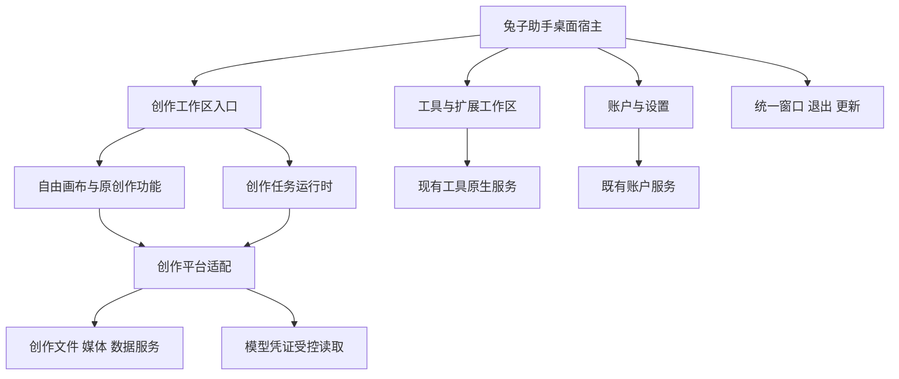

# 兔子助手 × opentu：统一客户端设计方案

版本：0.3，已获本地实施批准。日期：2026-11-01（Asia/Shanghai）。任务：UC-D02。

本版按用户提供的当前兔子助手截图纠正界面基线：保留 228px 侧栏、兔子账户、十个工具直达入口、已有工作区及底部设置，仅新增 opentu 创作入口。v0.1 将工具和扩展收进新一级分类的建议已撤回；不以重新组织整个客户端导航作为集成前提。详细画面、状态与改动落点见[界面设计 v0.2](opentu-unified-client-ui.md)。

用户已选择方案 B：一个主程序、两个业务工作区。2026-11-01 用户确认开始本地实施与预览，并随后指定以 AiW520/tuzi-switch 的 codex/assistant-main-sync 为宿主基线。各阶段完成情况以 UC-P01 实施记录为准，不代表完整集成或发布完成。应用仍沿用现有 TA-AC-1.5-B4 / system-token-v1 基线；本文不替代账户 PRD 的现行规则。

2026-11-01 UC-P01.2：用户明确移除截图中的工作流页签及其完整独立模块。当前创作范围为项目与自由画布；自由画布内的生图、素材、任务与生成编排共用能力保留。旧工作流本地数据不自动清空。

## 1. 交付目标与设计结论

用户安装一次“兔子助手”，可在同一窗口使用工具管理和 opentu 创作能力。统一应用身份、导航、账户入口、通用设置、退出和更新；保留两套业务各自的数据结构及执行规则。

推荐第一版采用：**当前兔子助手作为桌面宿主，opentu 作为随安装包交付、按需加载的本地创作模块。** 不依赖另装 opentu，也不把在线网页当作桌面功能的来源。

第一版的“统一”包括四件事：

1. 一个安装包、启动入口、主窗口和应用版本。
2. 一个全局导航和设置中心，工具与创作切换时保留各自上下文。
3. 兔子账户 Key 可以由用户主动配置给创作；第三方模型配置继续可用。
4. 旧用户数据有可验证、可中止、保留源数据的迁移路径。

不将新增聊天产品、云端项目协作、新 SSO、工具配置全面重写、创作媒体 WebDAV 同步纳入首版。opentu 已有的对话、自由画布创作、素材及任务能力属于保留范围，不能以“本次不新增聊天”为由删除既有功能。

## 2. 源码基准及未验证事项

| 项目 | 本轮只读核查结果 | 影响 |
|---|---|---|
| 兔子助手 | 原设计核查 gaizhao / c9928298；实施改以用户指定的 fork/codex/assistant-main-sync / `71314a670b4cca0e1aaf2b2af3295b4fca6d8ad8`，新 worktree 干净起步 | 后续集成基线必须包含哪些改动需明确记录，不能只记录 HEAD |
| opentu | codex/download-page-redesign，HEAD `7d05f299fec40599221294a34c9b26f888177c9e`；有未跟踪 outputs/ | 不复制构建产物、附件、node_modules 或真实用户数据 |
| 账户接口 | 当前文档为 system-token-v1 | 本方案预期复用，未核查 API 工作区或生产部署，不声称服务端已支持新增创作 DTO |
| opentu 桌面入口 | 启动 Web bootstrap、更新器、模型设置、导航和资源拦截器 | 不能直接 import 整个 main.tsx 到宿主 |
| 存储 | opentu.db、媒体目录、多个 IndexedDB / localStorage 命名空间 | 仅复制 SQLite 无法完整迁移 |

设计阶段未运行应用构建或真实模型请求；后续本地实施和验证见 [UC-P01](opentu-unified-client-implementation.md)。三平台安装、签名、内存及启动性能尚未测量；本文没有工期或性能完成承诺。

源码参考：

- 宿主：[导航](../../src/components/shell/TuziSidebar.tsx)、[工作区支持范围](../../src/config/workspace.ts)、[Tauri 外壳](../../src-tauri/src/lib.rs)、[安装身份](../../src-tauri/tauri.conf.json)。
- 现行约束：[PRD](PRD.md)、[接口契约](api-contract.md)、[账户文件 ADR-011](decisions/0011-local-account-file-and-hidden-codex-env.md)、[当前进度](progress.md)。
- opentu 来源仓库：`AiW520/opentuAI`，本机核查路径 `/Users/sdy09/.codex/worktrees/download-page-redesign/opentu桌面版`。
- opentu 重点文件：`apps/desktop/src/main.tsx`、`apps/web/src/app/bootstrap.tsx`、`apps/desktop/src-tauri/src/{lib,database}.rs`、`packages/drawnix/src/constants/storage-keys.ts`。

## 3. 用户界面与完整路径

### 3.1 导航组织

直接扩展现有 `TuziSidebar`，以用户截图和当前源码共同作为基线。左侧顺序为兔子账户 → 新增 opentu 创作 → 原工具列表 → 原工作区列表；设置仍位于底部。新入口采用现有行高、圆角和中性选中态，不创建替代现有侧栏的新导航框架。

| 现有位置或新增点 | 内容 | 页面行为 |
|---|---|---|
| 兔子账户，原位置 | 当前连接页、已公开密钥工作区和四项概要 | 保留截图中的连接卡，不重做登录，不开放隐藏页面 |
| opentu 创作，新增一行 | 右侧显示项目、自由画布及原素材/任务入口 | 进入创作自动将助手导航收至顶部浮层，画布占满宽度 |
| 工具，原位置 | 当前七工具和 Grok Build / Pi / MiniMax Code 十个直达入口 | 各工具仍一键进入，不收进“工具管理”二级页 |
| 工作区，原位置 | MCP、Skills、提示词、会话、授权、本机统计、Agents、统一供应商及条件入口 | 保留源码现有支持范围；截图下方未显示不意味着删除 |
| 设置，原底部 | 原设置分类追加“opentu 创作 / 创作数据” | 复用既有设置页和更新器，创作齿轮定位同一个设置页 |

“生成任务”只汇总创作任务，不把 CLI 历史会话伪装成可恢复任务。素材和历史内容优先复用现有页面；需要新汇总页时单独列入功能清单，不用空页面冒充集成完成。

### 3.2 默认进入位置

- 新安装：保留当前默认页面规则，不新增“开始创作 / 管理工具”分流首页；opentu 作为可见入口。
- 兔子助手升级：保留原工具及页面；增加一次可关闭的创作入口介绍。
- opentu 导入用户：导入成功后进入最近的创作项目。
- 设置可以修改启动位置。编辑页内未保存状态、当前画布、工具筛选分别保存，不共享同一个 last-view 字段。
- 沿用源码的侧栏展开 228px、收起 68px、页面标题栏约 52px。创作编辑器内不再并排放第二条常驻宽侧栏；项目选择使用下拉或抽屉。2026-11-01 用户进一步确认：进入 opentu 自动向上收起整条助手侧栏，顶部保留「兔子助手 ▾」；点击向下展开导航浮层，关闭不卸载画布，切至其他页面恢复既有 228px / 68px 偏好。替代早期手动专注模式。
- 在现有最小窗口附近必须实际验收；默认窗口大小不因接入 opentu 自动扩大到其原 1400×900。

### 3.3 三条关键用户路径

**兔子账户配置创作：**原兔子账户页 → 某条 Key 的“配置” → 新增“opentu 创作”目标 → 选择创作所需能力、模型和名称 → 保存 → 定位创作配置。保存不自动生成、不自动消费。

**第三方用户创作：**无需连接兔子账户 → 创作设置 → 新增第三方渠道 → 填写原有协议所需配置 → 自由画布显式选用。不读取或复用工具 OAuth、Coding/GACCode 凭证。

**创作与工具切换：**启动生成 → 切到工具页编辑配置 → 全局显示简洁任务状态 → 回到原项目查看结果。工具路由的切换不改变已经提交的创作任务渠道。

## 4. 架构与仓库组织



### 4.1 前端装配方式

首选单主窗口、可信本地模块、同一 React 运行时。提取 `@tuzi/creative-workspace` 导出可挂载入口，宿主 `src/features/creative/` 承接导航和平台适配。宿主仅新增 `creative` View（含有效恢复值），`TuziSidebar` 新增一行，复用 App.tsx 现有标题栏及内容区；不把创作加入工具 AppId，不重写工具和工作区导航。

| 关键选择 | 采用方案 | 代价与验收 |
|---|---|---|
| 全应用启动 | 宿主执行一次；创作只初始化其业务 | 拆除二次 createRoot、全局 bootstrap 副作用和独立更新器 |
| 路由 | 宿主管理顶层；创作内部路径由适配器承接 | 保留宿主现有 View 状态，创作页签不修改宿主 history/popstate；不要求全工具页改成 Router |
| 样式 | `.creative-root` 限定创作样式、reset 和弹层容器 | 覆盖 TDesign 样式及 portal；修正全局 body/document 副作用 |
| React 与依赖 | 单一兼容的 React 18 实例，锁定实测依赖版本 | 清理冲突别名、CSS 和构建 define；不复制旧 node_modules |
| 工作区切换 | 首次懒加载；任务服务与可见页面分离 | 离开视图停止快捷键、重绘；持久化与生成继续 |
| 错误隔离 | 创作根 ErrorBoundary + 独立恢复入口 | 能处理组件异常，不能宣称隔离整个 WebView 崩溃或内存耗尽 |

本方案不假定代码分包能提供安全沙箱或进程级故障隔离。若 P0 证明全局副作用无法合理拆除，才提出本地独立 WebView 的替代设计并比较三平台限制，不擅自更换方案。

### 4.2 建议目录

以下路径为拟议结构，不是当前已经存在的文件。首版只移动构建与运行必需部分，保留来源版权和固定上游版本记录。

```text
tuzi-switch/
  src/                          # 现有宿主及工具页面保留
    features/creative/          # 创作入口、导航及宿主适配
  packages/
    creative-workspace/         # 从 opentu 提取的应用业务入口
    drawnix/                   # 必需创作实现，保留来源结构与许可证
    creative-shared/            # 仅确有跨包引用的现有共享代码
  src-tauri/src/creative/
    mod.rs                     # CreativeState、初始化与生命周期
    commands/                  # creative_* 命令
    storage.rs                 # 独立创作存储路径和迁移状态
    media.rs                   # 媒体协议、授权与文件操作
    credentials.rs             # 创作模型凭证适配
  docs/development/
    opentu-unified-client-design.md
```

采用 pnpm workspace 管理本仓集成代码；opentu 源仓继续维护其 Web/独立版本所需入口。提取依赖闭包时记录源 SHA、实际来源文件和本地补丁，不将全仓永久复制后各自随意修改；后续每次上游同步走明确版本和差异审查。

不为首版建立通用插件框架、远程模块加载系统或复制整套 Nx 构建体系。若确有依赖必须保留，P0 列出原因及大小，而非预设全部删除。

### 4.3 Rust 装配

- 当前 `src-tauri/src/lib.rs` 是唯一 Builder / run 入口。
- 将 opentu `AppState` 改成独立 `CreativeState`，分别管理数据库、媒体路径授权和必要任务状态；不与现有 AppState 的数据库锁混用。
- 原 `get_local`、`save_file` 等通用命令改为 `creative_*` 命名，前端通过一处适配器映射。
- 沿用 `opentu-asset` 媒体协议的 URL 语义，保留路径授权、符号链接检查、类型和大小限制；不开放整个主目录。
- plugin-dialog / opener / store / updater 等在宿主统一注册并核对版本与权限；更新和窗口命令只归宿主。
- 整合两边 CSP 必需资源协议、worker、图片和视频源，逐项列原因；不简单取所有权限的并集。

## 5. 账户、模型及权限边界

### 5.1 凭证归属

| 类型 | 保存/使用者 | 统一后行为 |
|---|---|---|
| 兔子账户系统令牌 | 既有账户原生服务、ADR-011 独立本地 JSON | 规则不变；不提供给创作组件、媒体或生成任务 |
| 工具模型 Key / OAuth | 原工具凭证实现 | 保留原位置和语义；不自动成为创作凭证 |
| 创作模型 Key | 创作凭证适配层 | 新增配置拟使用原生系统安全存储；普通配置仅存 credentialRef；失败不降级明文 |
| 第三方创作鉴权信息 | 同上 | 支持原供应商协议与必要额外鉴权字段，按敏感字段受控保存 |

新创作凭证选择系统安全存储属于已批准方案中尚未实施的部分，不扩大 B13“账户系统令牌本地 JSON”的例外，也不改变现有工具机制。旧 opentu 渠道不在扫描时自动解密搬运：用户选定迁移渠道后验证安全存储再保存；不支持的旧加密格式提示重新填写。首次使用可能出现系统授权提示，需在三平台实测。

为了保留现有 JS 生成适配器，首版可受控提供单渠道短时内存凭证给可信创作运行时；渲染组件和常规模型列表只得到公开信息。严禁把内存凭证重新写入 opentu 的 localStorage / IndexedDB 配置序列化、导出或任务参数。不能据此声称可信 JS 运行时永远接触不到 Key。

### 5.2 模型配置关系

“统一设置”提供创作模型与工具模型的明确分类；首版不把两边不同格式的供应商表合成一张万能表。

创作配置分为渠道 Profile、能力绑定 Binding 和用途默认值三个层次。能力采用现有适配器实际支持的枚举；首版至少盘点 text / image / video / audio，不凭模型名称推断协议。特殊鉴权和自定义参数照原适配器保留。

自由画布按所需能力建立 Binding；不自动导入全部工具渠道。旧独立工作流的渠道和配置不再纳入本次集成或迁移范围。

账户 Key → 创作的关联新增独立目标类别 `creative`，不把它塞入现有工具 AppId 并顺带触发工具配置写入。原站点、用户、token 来源证明和资格验证继续复用；创作增加 capability / request schema 的真实兼容判断。若现有服务端元数据不足，进入受控“兼容性未确认”状态并列为接口缺口，不猜测模型能用。

断开或切换兔子账户后：清账户缓存与未保存凭证；暂停旧账户托管渠道的新提交和需要鉴权的恢复请求。已经提交的远端任务不声称被取消或退费；结果和历史仍归原来源，不改用新账户 Key 查询。第三方渠道和现有工具配置不受账户断开影响。

### 5.3 原生权限与扩展代码

同一 WebView 中的可信组件不能靠 TypeScript 接口、函数命名或 CSS 实现安全隔离。原生层仍验证来源、路径授权、账户代次和允许操作；创作 IPC 不提供任意执行命令、读取账户令牌或写工具配置的通用入口。

opentu 存在插件/脚本执行路径，需要 P0 单独盘点。外部可执行内容不能因集成自动继承主窗口全部 Tauri 权限。优先评估受限 Worker 或隔离内容容器、窄消息桥和无原生凭证环境；依赖 DOM 或特殊协议的插件须逐项验证。若无法保留其功能又隔离权限，提交功能影响供用户选择；不能默默删除扩展能力，也不能声称代码分包已解决问题。这个问题是公开发布门禁。

## 6. 平台接口草案

仅为进程内/原生 IPC 接口，版本暂定 `creative-host-v1`；不新增网络 `/api/desktop`。定稿时补齐请求/响应类型、错误码和可取消语义。

| 能力 | 拟议接口 | 约束 |
|---|---|---|
| 环境 | getEnvironment / subscribePreferences | 返回主题、语言、宿主版本和平台，不带秘密 |
| 导航 | navigateCreative / openCreativeSettings | 结构化目标和项目 ID；禁止任意 URL 指令 |
| 渠道 | listCreativeProfiles / resolveInvocation | 返回能力、模型和 profile revision；凭证走独立受控读取 |
| 凭证 | resolveCreativeCredential | 单 profile、用途及来源验证；短时内存，禁普通 query cache |
| 文件 | pickAsset / saveAsset / openAsset | 授权引用及资源 ID；校验路径，不开放任意磁盘读写 |
| 任务 | subscribeTasks / cancelTask / flushPendingWrites | 区分本地停止与远端取消，事件含序号及任务归属 |
| 退出 | prepareToLeave / prepareToQuit | 返回 dirty / running / saveFailed，不直接退出宿主 |
| 迁移 | inspectImport / planImport / applyImport / getImportStatus | 计划校验、阶段日志、幂等及失败恢复 |

通用错误至少覆盖 `credential_unavailable`、`source_changed`、`permission_denied`、`storage_full`、`revision_conflict`、`result_unknown`、`migration_incomplete`；普通错误信息不带上游秘密、完整请求或本地敏感内容。

## 7. 存储和旧数据导入

### 7.1 目标存储

沿用兔子助手的正式应用 identifier 与现有数据库路径。新创作原生数据放到应用数据目录的 `creative/` 子目录，分别保存 `opentu.db`、media、backups 和迁移日志。正式、测试/预览使用不同应用数据根。

首版保留创作 IndexedDB 的业务 schema，通过集中存储工厂配置新的命名空间；自由画布、任务、素材分别列清单。既有代码中分散使用的 localforage、indexedDB 和 localStorage 需完整盘点，不假设统一封装已经存在。

本轮不把全部画布数据库重写成 SQLite。账号令牌和原生模型凭证不进入任何普通导出；现有 WebDAV 的工具数据同步范围保持不变。

### 7.2 导入路径

不直接复制操作系统 WebView 的 IndexedDB 原始目录：其 origin、运行锁及格式可能不兼容。

推荐使用版本化交换包：旧 opentu 通过可用导出功能或兼容桥接版本在自己的运行环境导出逻辑记录、资源索引和必要文件；新助手解析并导入。需先核查旧导出的覆盖范围；如果缺少自由画布/任务等记录，必须补齐导出器。旧版升级桥接与发布需独立授权，不能承诺所有旧安装无需升级即可全量导出。

若旧应用无法运行，原生 SQLite / 媒体可走只读恢复入口；浏览器存储无法可靠恢复时明确列出未导入内容，不报告全量成功。

### 7.3 导入事务步骤

1. 扫描用户选择的来源，展示项目数、媒体大小、缺失文件、支持范围及剩余磁盘要求；扫描不写源数据。
2. 用户选择导入内容、目标目录、冲突处理。首版默认复制媒体，避免新旧应用共同清理同一目录。
3. 在独立 staging 目录和暂存数据空间导入；SQLite 使用一致性备份，不能在写入中只复制 `.db` 忽略 WAL。
4. 校验交换包 schema、路径、hash、资源引用及计数；同名项目默认另建并保留来源 ID 映射，不覆盖。
5. 导入状态记录到 journal；数据未齐时不向正常项目列表发布。全部校验后切换激活标记，完成版本化提交。
6. 重新打开项目验证引用；输出可读报告。重复导入依赖来源指纹和记录 ID 去重，允许明确“再导入为副本”。

文件、SQLite 与 IndexedDB 之间没有共同原子事务，采用 staging + journal + 激活标记恢复。中断后恢复/清理仅作用于本次创建且未被后续编辑的数据；原数据始终保留。大媒体可后续增加“复用外部目录”选项，但必须先定义旧客户端并发写入和删除保护；首版默认复制。

渠道秘密默认不随普通交换包导出，迁移后引导重新关联兔子账户 Key 或录入第三方 Key。账号来源匹配不能仅靠渠道名称判断。

## 8. 任务生命周期与性能

沿用 opentu 现有任务队列/恢复逻辑，补宿主生命周期接口，不建立第二套重复任务引擎。

| 用户动作或故障 | 要求行为 |
|---|---|
| 在创作与工具间切换 | 保留当前项目；生成、保存和进度订阅不因组件卸载丢失 |
| 切换渠道、模型或账户 | 已提交任务记录原 profile revision、模型及来源；不得随新设置改道 |
| 关闭到托盘 | 按现有宿主设置执行，进程仍运行时可继续任务 |
| 真正退出 | flush 写入；有未完成任务时说明可继续等待或退出；不承诺退出后本地还能执行 |
| 网络失败或崩溃恢复 | 有服务端查询契约时查询原任务；无契约标记结果待确认，不重发生成请求 |
| 用户取消 | 分别记录本地停止、远端已取消或远端状态未知；不承诺退款 |
| 媒体保存失败 | 保留远端结果引用及失败状态，不将任务标成完整交付 |

提交前持久化 attempt ID 与原渠道信息；需要幂等时依据供应商实际契约，不能仅生成本地 ID 就声称远端幂等。

性能策略：工具启动时不加载创作大型依赖；创作按需加载；切出暂停画布重绘、媒体播放和界面快捷键。运行中的任务服务保留，空闲视图在安全保存后可卸载。P0 记录原版基线；P1 后测首开、二次进入、切换、空闲与生成时内存，固定数据规模。预算在基线测量后冻结，不预先承诺体积、秒数或内存阈值。

## 9. 更新、平台与回退

- 保留 `com.tuziswitch.desktop`、现有 Windows 升级标识和 `tuziswitch` 深链。产品名拟继续“兔子助手”，创作区显示“opentu”。
- 一个应用版本、更新检查、下载和重启流程；集成构建关闭 opentu 独立桌面更新及其内嵌 Web 版本提示，模块版本仅用于诊断。
- opentu 原安装不冒用兔子助手签名或 updater 清单升级成另一个身份。推荐桥接版本提示安装统一客户端并导入数据；旧应用不自动卸载。
- 不直接修改已发布版本或覆盖相同版本更新包。最终版本号、渠道、发布账户和签名材料在发布阶段另行确认。
- 建立双方现有发布平台的并集核查矩阵：macOS ARM64 / x64、Windows x64、Linux x64 / ARM64；逐项确认宿主依赖可用性。构建成功与安装运行分别记录，不能静默缩减 opentu 平台支持。
- 回退使用完整旧版本安装包及迁移前备份；新创作数据 schema 超出旧版支持时不让旧版写入。不能承诺只降级可执行文件就能兼容全部新数据。
- 源码回退用独立提交 revert；导入失败的恢复遵循第 7 节，不删除旧应用或用户后续新增数据。

## 10. 新字段与兼容清单

以下是拟议持久化字段，开发时要为每个字段落实 schema、前后端类型、默认值、旧值读取、导入导出、测试和文档。未完成不得提交发布 PR；实际增减需同步本表。

| 数据对象 / 字段 | 默认或缺失处理 | 迁移与隔离 |
|---|---|---|
| CreativeNavigation.schemaVersion / creativeLocation | 新对象 v1；无历史进入项目页 | 宿主现有 last-view 追加 creative，有效性校验兼容旧值；不另设竞争的 lastWorkspace |
| 现有 sidebar collapsed 偏好 | 沿用现有值，不新增 sidebarMode 持久化副本 | 创作期间不改写原偏好，以 View 决定侧栏宽度为 0；返回直接使用原偏好 |
| CreativeProfile.id / revision / credentialRef | UUID、初始 revision；无引用则 needsCredential | 原生凭证不进普通导出 |
| CreativeProfile.sourceKind / accountSource | manual 或 tuzi-account；账户来源缺失不推断 | 来源绑定 origin/user/token，不从名称猜测 |
| CreativeBinding.profileId / capability / modelId / requestSchema / usage | 无兼容绑定即要求选择 | 创作用途与工具用途独立，旧手动渠道不自动改写 |
| Task.sourceSnapshot / attemptId / recoveryState | 无旧信息标 legacy-unknown | 优先扩展现有任务字段，不重建队列；旧任务不自动补发 |
| ImportJournal.schemaVersion / importId / sourceFingerprint / phase / counts / idMap | 缺失视为未开始 | 中断按已完成阶段恢复；日志排除秘密 |
| CreativeStorage.schemaVersion / namespace / mediaRoot | 新命名空间及应用内 creative/media | 测试与正式分离；路径受授权与校验 |

账户 B13 本地记录版本不因创作集成自动改变。数据库迁移编号必须以编码时实际基线为准，不在设计稿预占当前未提交 MCP 所使用的编号。

## 11. 实施分期与可验收交付

| 阶段 | 具体交付 | 阶段验收 / 停止条件 |
|---|---|---|
| UC-P0 基线与可行性 | 固定双方源码与工作树清单；功能/命令/存储/插件清单；最小本地装配实验 | 项目与自由画布可进入；明确凭证、CSS、路由、插件和旧导出阻塞；不满足则先修订设计 |
| UC-P1 单外壳 | workspace 包、CreativeState、媒体协议、统一导航及设置入口、拆独立 updater | 一个安装程序启动；工具回归通过；画布保存、媒体预览、重启恢复；创作崩溃可返回工具 |
| UC-P2 配置与任务 | 创作凭证适配、账户“配置到创作”、显式用途绑定、任务后台运行、退出处理 | 切页不中断；切号不串用；模型 Key 无持久缓存/导出泄漏；未知结果不重复提交 |
| UC-P3 迁移 | 全量逻辑导出覆盖、staging/journal 导入器、冲突与恢复报告 | 图片/视频/自由画布/历史引用正确；磁盘满和中断可恢复；重复导入不覆盖；源数据不变 |
| UC-P4 验收与发布准备 | 平台矩阵、安装升级与回退、签名/更新链路、性能报告和用户验收 | 逐平台证据齐全，安全阻塞清零；发布另行授权 |

P1 可交付内部预览，但不称为完整统一客户端。公开交付需要目标范围内 P2–P4 完成；完整 opentu 功能清单在 P0 冻结，不能用“画布能打开”替代其余能力验收。

不在未知依赖和迁移覆盖未确认时承诺固定天数。主要工作量是全局初始化拆分、完整创作功能回归、凭证与插件边界、跨存储迁移；界面导航本身不是主要成本。

## 12. 验收矩阵

| 编号 | 场景 | 通过标准 |
|---|---|---|
| UC-AC-01 | 全新安装 | 无需另一应用、Node 或用户启动本地开发服务；一个应用入口 |
| UC-AC-02 | 原助手用户升级 | 账户、工具配置、代理、MCP/Skills/Agents/会话及页面定位兼容 |
| UC-AC-03 | 完整创作回归 | 按 P0 清单覆盖自由画布、媒体、导入导出及原创作功能 |
| UC-AC-04 | 主题和弹层 | 浅深色、最小窗口、全屏、中文/现有语言、快捷键无跨区冲突 |
| UC-AC-05 | 生成期间切页 | 工具操作与任务互不改路由；返回同项目、任务状态一致 |
| UC-AC-06 | 切号与失效 | 新任务拒绝旧来源，迟到响应归属正确，系统令牌不进入创作 |
| UC-AC-07 | 任务未知结果 | 超时、强退、断网恢复不重发 POST；未支持查询时明确状态 |
| UC-AC-08 | 导入失败 | 中途退出、磁盘满、权限失败、坏包、缺图、路径穿越均可处理 |
| UC-AC-09 | 导入完整性 | 计数、hash、引用及项目打开验证；旧数据保持；二次导入幂等 |
| UC-AC-10 | 凭证与扩展 | 日志/导出/普通缓存无秘密；外部可执行内容不能调用宿主高权限 |
| UC-AC-11 | 更新与回退 | 单一提示、运行中任务保护、签名验证、失败恢复及旧数据可用 |
| UC-AC-12 | 性能和平台 | 原版对照测量；各承诺平台安装运行证据，不以 CI 构建替代 |

合成 HTTP / 原生测试、真实 UI、实际供应商联调、发布和用户验收分别记录。真实模型调用可能计费，需要单独授权；不能用 Mock 声称真实上游通过。

## 13. 风险与决策状态

| 风险 | 处理方式 | 决策状态 |
|---|---|---|
| 原工作区存在 MCP 未提交改动 | 按用户新指示，从 assistant-main-sync / 71314a67 独立 worktree 实施；原改动保留且未带入 | 基线已冻结 |
| 插件继承宿主权限 | P0 清单与隔离试验；冲突必须呈现给用户 | 发布阻塞，未解决 |
| 旧 IndexedDB 无全量出口 | 核查交换格式并补桥接导出；保留恢复限制 | P0 验证项 |
| 同窗口复杂业务扩大故障范围 | 懒加载、停止闲置重绘、ErrorBoundary；测资源后再决定额外隔离 | 不承诺进程隔离 |
| 双方持续开发导致代码分叉 | 固定来源版本及补丁清单；每次同步有功能和回归差异 | 本稿推荐 |
| 两个 updater / 版本提示混用 | 所有集成桌面更新归宿主；独立版构建显式保留原逻辑 | 必须实现 |

已经确认：用户选择 B，并批准基于现有侧栏开始本地实现和预览。

已批准的界面约束：基于当前兔子助手集成，保留现有侧栏与工具直达；opentu 单入口放在账户下方，右侧采用项目/自由画布设计。导航宽度沿用现有实现。创作新凭证存储和旧数据导入仍为后续实施门槛。

当前实施使用 `codex/opentu-assistant-sync`，基于用户指定的 `codex/assistant-main-sync` / 71314a67；精确 SHA 和变更范围见 UC-P01。创作包内已记录 OpenSpec 提案。本轮不包含 push、PR、发布、真实凭证访问或付费请求授权。

## 14. 本轮设计交付状态

- 已完成：源码只读核查、方案 0.2，以及基于用户截图重做的界面设计。旧版五入口草图仅为历史提案，不再是执行依据。
- 本地实施：已完成 UC-P01 首条前端预览路径，详情见 [实施记录](opentu-unified-client-implementation.md)。原生适配、凭证与任务、迁移、安装更新等剩余门槛仍未完成。
- 文档检查仅验证链接、结构与草图本地交互，不等于应用功能测试。

v0.1 历史检查记录：8 个本地文档/源码链接均存在，Markdown 代码围栏成对，UC-AC-01～12 编号齐全；当时 `git diff --check` 通过。旧交互稿检查五分类导航及配置流程；该导航已被 v0.2 替代，不作为现行 UI 设计依据。

v0.2 检查记录：总体方案 9 个相对链接、界面稿 1 个相对链接有效；图标使用仓库现有资源。Chrome + Playwright 检查账户/原工具/原工作区/opentu/设置切换、专注模式退出恢复、模型必填和第三方配置入口；1024 / 954 / 900 / 736 / 390 / 320 像素宽度的代表页面和项目/画布/工作流无横向溢出，无页面脚本异常或图片加载失败。窄屏仅验证设计稿展示，不承诺移动端产品。上述为设计稿阶段的历史验证；当前业务集成状态见 UC-P01，原生构建、真实账户/模型调用仍未执行。
